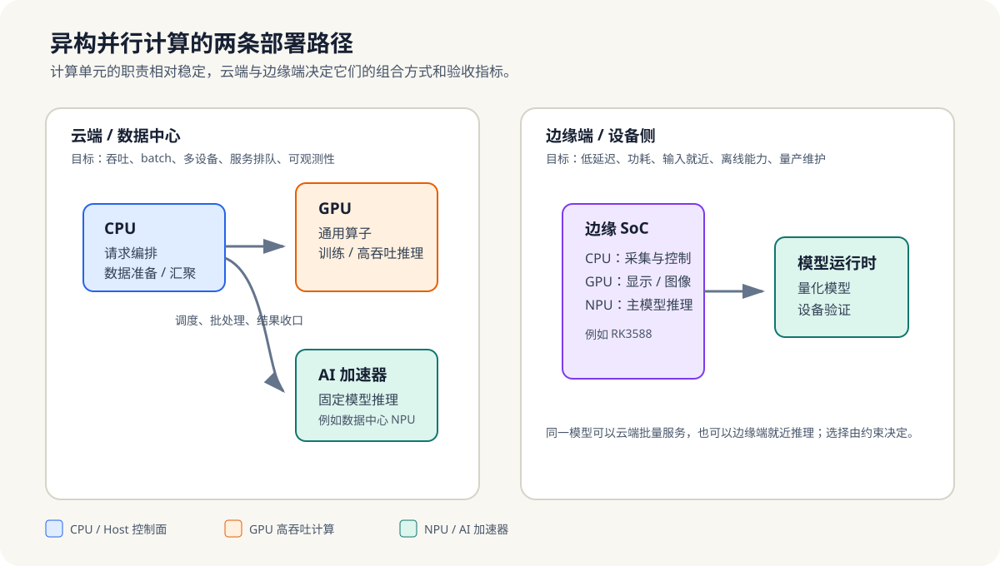

# 教程文档架构

> 本文件定义教程的内容边界、章节职责和维护规则。它回答“为什么这样编排”；运行命令见 [USAGE](USAGE.md)，环境前置条件见 [ENVIRONMENT](ENVIRONMENT.md)。

## 1. 教程定位

本教程面向需要交付异构计算系统的工程师。主线不是分别介绍 CPU、GPU、NPU，而是说明它们如何在云端和边缘端分工：



*图 1-0：CPU 在两侧都承担控制面职责；GPU 和数据中心 AI 加速器更常服务云端高吞吐负载，边缘 SoC 则把 CPU、GPU、NPU 集成到更受功耗和输入链路约束的设备中。*

```text
CPU 负责任务、数据和同步控制
GPU 负责灵活的高吞吐通用计算
NPU 负责固定模型的高能效推理
云端 / 边缘端决定三者的组合、约束和验收指标
```

- 云端关注吞吐、batch、多设备、服务排队和可观测性。
- 边缘端关注输入链路、单请求延迟、功耗、离线能力和量产维护。
- OpenCL / SYCL 服务于可移植性约束，不替代 CUDA 或 AI 加速器主线。
- TPU 只作为 AI 加速器设计取向的对照；本书不承诺 TPU 平台实操。

## 2. 固定章节结构

当前保留第 1-16 章编号和目录路径。调整章节职责时，优先修改目录页、`intro.md`、根 README 和本文件；不要为了改命名迁移正文文件。

| 阶段 | 章节 | 职责 | 读完后的判断 | 配套实验 |
|---|---:|---|---|---|
| 基础模型 | 1 | 并行的动机、上限与云边场景 | 为什么需要并行，收益上限在哪里 | `ch09_vec_add` 作为最小观察 |
| 基础模型 | 2 | 并发时序、同步、可见性与任务生命周期 | 哪些并发关系会出错 | 无独立项目 |
| 基础模型 | 3 | 数据并行、任务并行、流水线与代价 | 如何选择拆分模式 | 无独立项目 |
| Host 控制面 | 4 | 线程、线程池与任务承载 | 任务怎样被安全执行和收口 | `ch04_task_pool` |
| Host 控制面 | 5 | OpenMP 循环并行与调度 | 规则工作怎样划分给 CPU | `ch05_openmp_blur` |
| Host 控制面 | 6 | SIMD、数据布局与局部效率 | 何时适合向量化 | `ch06_simd_layernorm` |
| Host 控制面 | 7 | 数据放置、搬运、异步提交与同步 | Host 如何控制设备节奏 | `ch07_host_overlap` |
| GPU / 云端 | 8 | 执行模型、内存边界与加速器选择 | 哪些负载值得交给 Device | `ch09_vec_add`、`ch09_reduce` |
| GPU / 云端 | 9 | CUDA 编程与基础算子 | 如何把工作映射成 kernel 和内存访问 | `ch09_vec_add`、`ch09_reduce`、`ch09_gemm` |
| GPU / 云端 | 10 | 性能分析、融合与云端服务视角 | 瓶颈在 kernel、Host 供给还是排队 | `ch10_fused_softmax` |
| AI 加速器部署 | 11 | 模型转换、量化、运行时与设备验证 | 固定模型如何稳定部署 | `ch11_classification_infer`、`ch11_npu_deploy` |
| 跨平台选读 | 12 | OpenCL / SYCL 的可移植性边界 | 可移植性是否值得额外成本 | 无强制项目 |
| 系统测量 | 13 | 端到端测量、瓶颈分类与复测 | 如何建立可复现的性能结论 | GPU 算子实验 |
| 云边案例 | 14 | 云端推理调度、边缘视觉与流水线 | 同一方法如何适应部署位置 | `ch14_face_detection`、`ch14_attention_pipeline` |
| 系统协同 | 15 | 任务图、同步点、多设备协同 | 如何让多设备稳定协作 | 第 14 章项目 |
| 部署决策 | 16 | 云边选型、成本、量产与风险 | 如何在约束下做最终选择 | 场景化练习 |

## 2.1 文档路径与命名

教程正文的固定层级为 `Part -> Chapter -> Section`：

```text
docs/
  partNN-topic/
    chapterNN-topic/
      README.md
      intro.md
      NN-section-topic.md
```

- 分篇目录使用 `partNN-topic`，章节目录使用 `chapterNN-topic`，正文小节使用 `NN-section-topic.md`。
- 路径一律使用小写 ASCII 和连字符（`kebab-case`）；不使用下划线，不混用同义缩写。
- 章节编号由父目录表达，正文文件只保留本章内小节号；`README.md` 是目录页，`intro.md` 是正文入口。
- 新增或重排小节时，先确定本章内顺序，再更新章节目录、分篇目录、根 README 与任务页。
- 路径规则变更必须一次性迁移全书、更新链接并运行链接审计；不得让旧、新路径长期并存。

## 3. 阅读入口

- 根 [README](../README.md)：面向新读者的定位、16 章总览和角色路径。
- 分篇 `README.md`：解释该篇职责和章节顺序。
- 章节 `README.md`：只做目录和实验入口。
- 章节 `intro.md`：说明本章问题、机制、实验语境、小结和下一章过渡。
- 正文小节：只展开一个具体概念、机制或案例。
- [USAGE](USAGE.md)：最短阅读路径和可运行命令。
- [第二阶段专题路线](phase2/README.md)：完成第一阶段后的项目化深入方向与验收边界。

## 3.1 正文层级模板

模板用于统一信息层级，不要求每章写成相同篇幅。短小的过渡章可以合并相邻项，但不能省掉本章问题、边界和下一步去向。

| 层级 | 必须回答的问题 | 固定内容 | 不应承担的内容 |
|---|---|---|---|
| 分篇 `README.md` | 这一篇解决什么、与前后篇如何衔接 | 篇目标、主图、章节职责、阅读路线、范围边界 | 逐节解释机制、罗列内部建设进度 |
| 章节 `README.md` | 本章有哪些入口、如何开始实践 | `intro.md`、有序小节、示例、前置条件和预期输出 | 重复导语叙述或展开原理 |
| `intro.md` | 为什么学习、机制主线是什么、读完能判断什么 | 中心问题、前章过渡、最小机制模型、阅读路径、实验语境、章小结与下一章过渡 | 逐节复述正文或成为 API 清单 |
| 正文小节 | 一个概念、机制或案例如何成立 | 问题与前提、机制、约束与代价、最小观察、节小结与过渡 | 覆盖多个无直接关系的主题 |

正文小节的通用叙事顺序为：`问题 -> 机制 -> 约束/代价 -> 观察或示例 -> 小结/过渡`。实验的统一产出为一条可复查的证据，例如正确性结果、编译器报告、时间线、转换报告或选型记录；不把一次机器上的时间数字表述为通用结论。

三篇的机制重心不同：

- 第一篇优先写成“问题 -> 概念模型 -> 条件与代价 -> 判断卡”。
- 第二篇优先写成“工作表达 -> 并行机制 -> 正确性/性能约束 -> 运行证据”。
- 第三篇优先写成“是否卸载 -> Device 执行或部署机制 -> 测量/验证 -> 选型边界”。

## 4. 平台映射

| 平台 | 教学归类 | 主要部署侧 | 文档位置 |
|---|---|---|---|
| 沐曦曦云 C500 | 数据中心通用 GPU | 云端或私有化数据中心 | 第 8-10、14-16 章 |
| Jetson Orin Nano | 含 CUDA GPU 的边缘 AI 计算机 | 边缘端 | 第 7、9-10、14、16 章 |
| 昇腾 910B | 数据中心 AI 加速器 / NPU | 云端或私有化数据中心 | 第 11、14-16 章 |
| RK3588 | 含 CPU、GPU、NPU 的边缘 SoC | 边缘端 | 第 7、11、14、16 章 |

平台名称用于建立部署语境，不替代厂商 SDK、硬件规格或兼容性验证。

## 5. 真实与模拟边界

- 教学脚手架必须标注为 `simulated` 或“教学模拟”，不能把固定画像当作硬件实测。
- 真实结果必须记录平台、软件版本、输入规模、测量口径和失败条件。
- 文档引用示例时，应说明它验证的是正确性、机制、性能趋势还是实际设备部署。
- 不能在没有真实工具链和设备的情况下声称完成某厂商后端闭环。

## 6. 变更规则

- 新增正文前，先确定它属于 Host、GPU/云端、AI 加速器、跨平台选读或系统决策中的哪一类。
- 新增项目必须同时更新章节目录页、[示例索引](../examples/README.md) 和 [USAGE](USAGE.md)。
- 若新增内容改变读者路径，必须同步更新根 README、分篇目录和本文件。
- 章节编号保持稳定；目录路径和文件名必须遵守“路径与命名”规则。路径迁移完成前不得提交半迁移状态。
