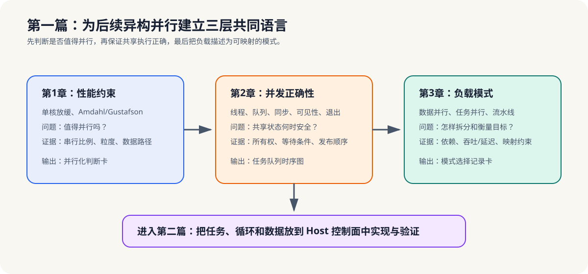

# 第一篇：并行计算的系统基础

## 分篇定位与总览图

第一篇建立异构并行计算所需的最小判断基础：一个负载是否值得并行、多个执行流怎样保持正确、工作关系怎样翻译成可复用模式。它不教授具体设备 API，而是为后续 Host、GPU 和 NPU 章节提供共同语言。

*学习路径图：第一篇依次建立性能收益、并发正确性和工作负载模式三层判断。第 4 章开始将这些判断落实为 Host 侧的可运行模型。*

## 前置基础

第一次学习本教程可从本篇开始，不要求先掌握线程库、GPU 编程或 AI 加速器工具链。

## 章节职责

| 章节 | 中心问题 | 阶段产出 |
|---|---|---|
| [第 1 章：为什么需要并行计算](chapter01-why-parallel/README.md) | 这个负载值得并行吗？ | 并行化判断卡 |
| [第 2 章：操作系统层面的并行基础](chapter02-os-parallel-basics/README.md) | 共享状态如何安全协作？ | 任务队列设计卡 |
| [第 3 章：并行模式入门](chapter03-parallel-patterns/README.md) | 工作应该怎样组织与描述？ | 模式选择记录卡 |

三章围绕同一个视频分析流水线逐步形成判断，而不是三份互不相干的作业：第 1 章识别帧预处理的工作单元、依赖、数据位置和测量目标；第 2 章明确采集到工作线程的交接规则；第 3 章补充任务/数据并行模式、服务目标、候选执行位置和验证证据。这些跨章信息统一收录在[工作负载记录卡](../learning-tools/workload-record-card.md)中。

## 阅读路线

- **完整路线**：第 1 章 -> 第 2 章 -> 第 3 章，依次回答“是否值得并行 -> 如何安全并发 -> 如何描述工作”。
- **性能判断**：先读第 1 章，建立收益、输入规模和测量口径。
- **并发正确性**：先读第 2 章，建立共享状态、等待、发布和关闭规则。
- **模式与选型**：在完成前两章后读第 3 章，建立模式、目标和候选执行位置的关系。
