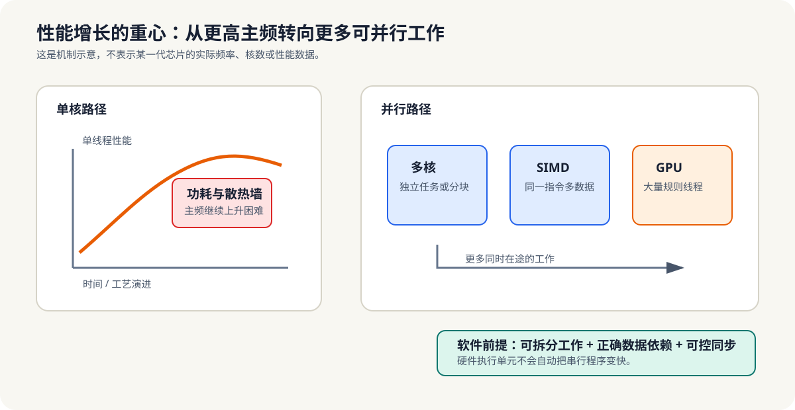

# 1.1 单核时代放缓与多核时代

早期的程序员往往不需要太关心并行。那时硬件每隔一段时间就会自然变快，应用程序即使不做太多改动，也能从新一代 CPU 中直接受益。于是“等硬件升级”一度成为很多软件性能提升的默认路径。

但这种路径建立在两个历史条件上：晶体管数量持续增加，单核频率也还能继续抬高。今天这两个条件都不再成立，硬件性能增长的主战场已经从“更快的单核”转向“更多的并行执行单元”。

过去二十多年里，大家习惯了“新 CPU 自然更快”。现在这件事不再自动成立。

- 单核频率提升触及功耗墙和散热墙，继续拉高主频的收益越来越小。
- 性能提升逐步转向多核、SIMD、专用加速器和更好的并行软件组织。
- 这意味着“买更强的硬件”不再自动等于“程序变快”，串行代码会明显撞上天花板。

*图 1-1：主频受功耗与散热约束后，性能增长更多依赖多核、SIMD 与加速器。但硬件不会自动并行化串行程序，软件仍须提供可拆分工作、正确依赖和可控同步。*

这里有一个常被忽略的事实：即使芯片上有更多执行单元，如果软件不能把足够多的工作同时喂给它们，很多硬件能力也会处于空转状态。并行计算的价值，不只是“更快”，还在于“把闲置的计算资源组织起来”。

从工程角度看，这一变化带来的不是“要不要写并行代码”的选择题，而是“你能不能把问题拆开”的生存题。  
如果任务结构不变，硬件升级带来的收益会越来越有限；只有把任务拆成可以并行推进的部分，算力增长才会真正转化为性能提升。

可以把这个变化理解成一次结构性迁移：

- 以前，性能提升主要靠单核提频和微架构优化。
- 现在，性能提升更依赖多核协作、SIMD、专用加速器和更好的软件组织。
- 以前，程序可以默认等硬件变快。
- 现在，程序必须主动学会把工作拆开。

**小结**
单核频率放缓和多核普及，意味着性能提升不再主要来自硬件自动进步，而是来自软件如何组织并行。第1章后面的内容，都是围绕这个前提展开的。
