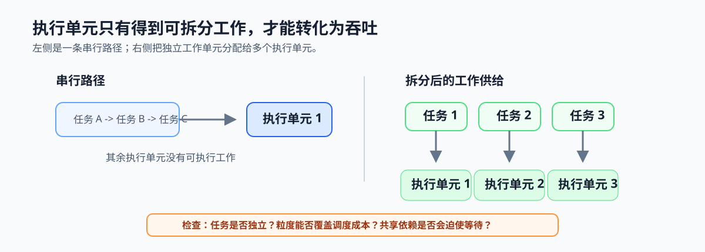

# 1.1 单核时代放缓与多核时代

## 本节导读

一个视频分析程序即使换到更新的机器，若仍按单条串行路径处理全部帧，新增的核心和向量执行单元也未必能缩短总时间。问题不在于硬件是否更强，而在于软件是否能持续提供可同时推进的工作。

本节说明性能增长为何从提高单核频率转向增加并行能力，并建立“硬件执行单元需要软件供给工作”的基本判断。下一节再用两条定律量化这种判断的收益上限。

### 1.1.1 单核提频先受到功耗和散热约束

过去，程序即使不改动，也常能从更高频率和更强单核性能中获得收益。频率继续提高会同时提高功耗和散热压力，单核路径的边际收益因此收窄；硬件性能增长逐步转向更多核心、SIMD 通道和专用加速器。

*图 1-1：主频受功耗与散热约束后，性能增长更多依赖多核、SIMD 与加速器。硬件提供更多执行能力，但不会自动改写串行程序。*

### 1.1.2 更多执行单元需要持续的工作供给

多核、SIMD 和加速器只能执行已经被软件拆开的工作。若所有视频帧仍按“读取一帧、处理一帧、写回一帧”的单条路径执行，其余执行单元会在等待中空闲；把独立帧、像素块或请求拆成多个工作单元后，调度器才有机会同时分配它们。

软件需要同时满足两项条件：工作单元足够独立，且每个单元的输入、输出和依赖关系已经明确。缺少任何一项，更多执行单元都难以转化为有效吞吐。

### 1.1.3 拆分工作也会带来协调成本

工作被拆开后，程序还要承担创建任务、调度、同步、合并结果和搬运数据的成本。任务过小会让这些成本超过实际计算；依赖链过长会让部分执行单元提前等待；共享数据过多还会引入额外同步。

因此，并行化的目标不是让所有硬件单元始终忙碌，而是在独立工作足够多时，用可接受的协调成本换取更短的总完成时间。

### 1.1.4 用工作供给检查决定是否进入并行设计

开始并行化前，先确认负载是否存在可同时推进的工作单元、这些单元是否共享关键状态，以及单元规模能否覆盖调度与同步成本。三个问题都能回答清楚时，再进入第 1.2 节的收益上限评估。

*图 1-2：串行路径只让一个执行单元推进；拆成相互独立的工作单元后，多个执行单元才能同时处理。共享依赖和过小粒度会重新压缩这种并发。*
