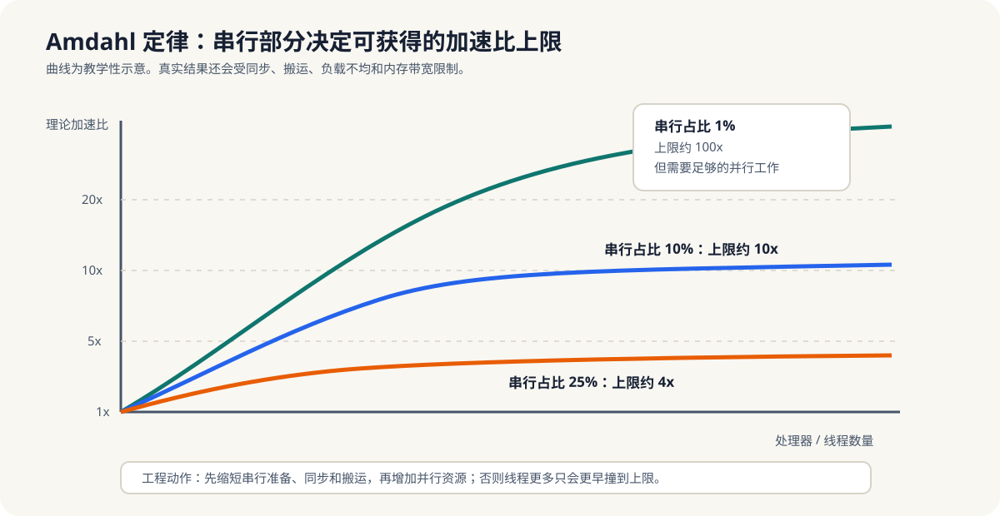

# 1.2 Amdahl 定律与 Gustafson 定律

进入并行以后，读者最容易产生的第二个误解，就是把“多开线程”直接等同于“更快”。现实并不是这样。  
一旦任务被拆开，真正决定收益的，不只是有多少执行单元可用，还包括有多少部分必须顺序执行、同步、拷贝、等待和汇合。

所以，第1章需要一组理论工具来回答两个问题：

1. 并行加速的上限到底在哪里。
2. 当问题规模一起增长时，并行为什么又会显得更有价值。

这就是 Amdahl 定律和 Gustafson 定律要解决的事情。

- **Amdahl 定律**：固定问题规模下，串行部分决定加速上限。
- **Gustafson 定律**：问题规模随算力增长时，可扩展性更乐观。

设 `f_s` 为串行部分占总执行时间的比例，`p` 为并行资源数量。固定问题规模下，Amdahl 上限为：

```text
S_max = 1 / (f_s + (1 - f_s) / p)
```

当 `f_s = 0.2` 且 `p` 趋近无限时，`S_max` 仍只有 `1 / 0.2 = 5`。这就是“20% 串行部分最多约 5x”的来源。Gustafson 则把串行比例放在 `p` 个资源上的同一测量窗口内：

```text
S_G = p - f_s (p - 1)
```

两式的变量含义和测量边界见[附录 E：公式与指标表](../../appendix/E-formulas-and-metrics.md)。它们描述理想模型，不包含同步、搬运、负载不均和带宽等实际代价。



*图 1-2：串行占比越高，增加处理器或线程越早触及上限。曲线只说明理论上限；同步、搬运、负载不均和带宽会让真实结果更低。*

可以把 Amdahl 定律理解成一个工程判断：

- 如果一个任务里有 20% 不能并行，那么就算其余 80% 能无限快，加速比也不可能无限大。
- 串行部分不仅包括“真正只能顺序做”的计算，还包括同步、拷贝、调度、归约和等待。
- 所以并行优化真正要做的，不只是“把代码拆成很多份”，还要尽量压缩串行尾巴。

从教材角度看，Amdahl 定律的意义是给“理想化并行”泼一盆冷水：不是所有工作都能无限拆，串行尾巴永远会限制上限。  
这也解释了为什么很多实际优化不只是加线程，而是同时要优化数据布局、减少同步、压缩传输和合并阶段。

Gustafson 定律则从另一个角度说明：当问题规模随着硬件能力一起扩大时，并行系统往往更有价值。

- 例如图像分辨率更高、模型更大、批量更大、流水线更深，都会让更多并行资源有活可做。
- 这也是为什么很多 AI 和图形任务天然偏向并行：它们不是固定小问题，而是会随着资源增加而主动变大。

从教材角度看，Gustafson 定律的意义是把视角从“固定问题能快多少”切换到“资源变强后能把问题做多大”。  
这对 AI 训练、图形渲染和大规模数据处理尤其重要，因为这些场景里，更多算力往往不会让问题保持不变，而是会把可处理规模一起推高。

📋 这两条定律是判断“值不值得并行化”的第一把尺子，也是判断“并行化后收益会不会被同步开销吃掉”的第一把尺子。前者看固定规模下的上限，后者看规模增长时的扩展性。

**小结**
Amdahl 定律提醒我们不要高估并行加速上限，Gustafson 定律提醒我们不要低估规模增长时并行的价值。两者放在一起，才能比较完整地理解并行收益。
