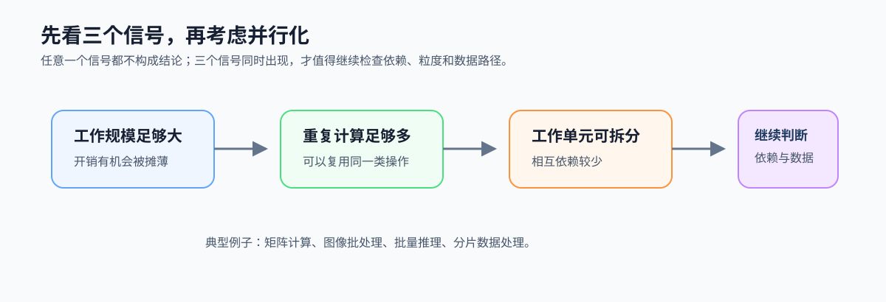
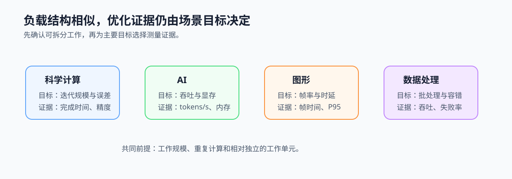

# 1.3 并行计算的应用场景

## 本节导读

知道并行有上限后，下一步不是直接选择硬件，而是识别负载是否有足够多、足够规则且相对独立的工作。视频分析中的帧预处理、矩阵计算和服务流水线都可能满足这些条件，但它们要优化的目标并不相同。

本节把真实场景翻译成工作结构和性能目标。读完后，应能说明一个负载为何值得并行，以及应以吞吐、延迟、稳定性还是资源利用率作为主要证据；第 1.4 节再把判断写成记录卡。

### 1.3.1 先从工作结构识别并行机会

工作规模足够大、重复计算足够多、工作单元可以相对独立地拆分，是进入并行设计的三个基本信号。视频帧的预处理、科学计算的网格和矩阵、批量推理的样本、ETL 的分片都可据此识别。

*图 1-5：工作量大、重复计算多且能拆成相对独立的单元时，才具备并行化的基本条件。三个信号同时出现后，再检查依赖、粒度和数据路径。*

### 1.3.2 大模型是同一判断方法的迁移案例

大模型训练包含大规模矩阵计算、反向传播和参数更新，适合观察数据并行与算子并行。推理同时面对单请求延迟和批量吞吐；prefill 更接近批量计算，decode 更受逐 token 依赖约束。KV cache、显存和数据传输又把数据位置与复用带入性能判断。后续可通过 [`ch14_attention_pipeline`](../../../examples/ch14_attention_pipeline/README.md) 观察这一判断怎样落到多阶段推理流水线。

因此，大模型不是第一篇的第二条主线，而是迁移案例：仍先识别工作单元、依赖、数据位置和目标，再讨论模型、设备或框架。

### 1.3.3 场景差异会改变优化目标

科学计算通常优先关注迭代规模、误差与完成时间；AI 更关注吞吐、显存与算子数据路径；图形关注帧率和稳定时延；数据处理关注批处理吞吐、shuffle 与容错。相同的可拆分结构，在不同目标下会选择不同的并行组织方式。

先写清主要目标，才能判断应该扩大 batch、缩短关键路径、稳定流水线，还是减少数据搬运。

### 1.3.4 用目标与证据把场景变成工程判断

为一个负载选择并行方案前，先记录工作单元、主要约束和需要观察的证据。这样能避免只因某个场景常使用 GPU 或 NPU，就跳过实际的结构与目标判断。

*图 1-6：不同负载的共同前提是可拆分工作，但主要目标决定应记录吞吐、延迟、资源占用或正确性等不同证据。*
