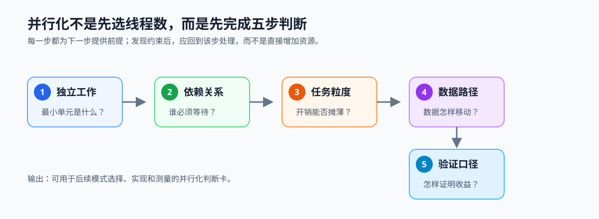
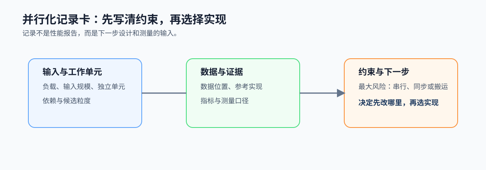

# 1.4 并行化前先完成五个判断

## 本节导读

前面已经说明为何需要并行、收益如何受限、哪些负载值得考虑。真正开始改代码前，还要把“可能并行”变成可复查的工程判断：工作是否独立、依赖是否可控、任务是否足够大、数据如何移动，以及用什么证据验证结果。

本节把这五项写成一张记录卡。读完后，应能为一个负载留下可复查的并行化假设；第 2 章将展开其中的共享状态、顺序和同步问题。

### 1.4.1 五个判断条件按依赖顺序展开

先识别独立工作单元，再标出依赖，随后检查粒度、数据路径和验证口径。前一项不成立时，后一项没有可靠基础：找不到独立单元或依赖链过长时先处理算法和串行热点；粒度过小时先合并任务；搬运过多时先减少重复读取。

*图 1-7：先找到独立工作，再确认依赖、粒度和数据路径，最后定义正确性与测量口径。每一步为下一步提供前提。*

### 1.4.2 用向量加法检查五项条件

向量加法中，每个元素 `c[i] = a[i] + b[i]` 是独立工作单元，计算阶段没有跨元素依赖；每个单元读取两个输入并写一个输出，可与串行参考逐元素比较。小输入时，线程和同步开销可能超过计算本身。

这个例子只验证判断方法，不代表真实负载没有依赖。可以运行 [`ch09_vec_add` 的 CPU 路径](../../../examples/ch09_vec_add/README.md)观察输入规模变化；命令与记录要求见 [Task 1](../../TASKS.md#task-1建立并行问题模型)。

### 1.4.3 约束决定先改哪里

独立性不足时先重构算法或减少串行阶段；粒度不足时合并任务或批量化；数据路径过长时减少往返与重复读取；验证口径不清时先固定参考实现、输入和测量范围。硬件与线程数的选择应放在这些约束之后。

### 1.4.4 把判断写成可复查的记录

以视频分析流水线为主案例，在[工作负载记录卡的工作与收益区](../../learning-tools/workload-record-card.md#1-工作与收益)中为预处理阶段写下工作单元、依赖、数据位置、候选粒度、正确性参考、测量口径和当前最大风险。`vec_add` 只作为最小数据并行对照。第 2 章会把共享数据、顺序和同步展开为队列正确性问题；第 3 章再把这张记录翻译为并行模式与硬件约束。

*图 1-8：记录卡将五项判断收束为输入、约束、证据和下一步动作，避免在尚未定位风险时直接选择线程数或设备。*
