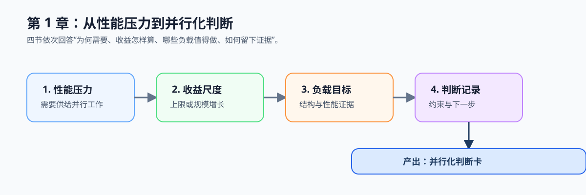

# 第1章 为什么需要并行计算

## 章节定位与总览图

本章建立进入异构并行计算前的第一张判断卡：一个负载为何值得并行、收益受什么限制、应记录哪些证据。它是第 2 章并发正确性和第 3 章并行模式的前提。

*学习路线图：先理解性能增长为何转向并行，再评估收益尺度、识别负载和写出判断记录，最终产出并行化判断卡。*

## 前置基础

- 无；第一次阅读本教程可从本章开始。
- 如需运行配套代码，先完成 [Task 0：建立运行基线](../../TASKS.md#task-0建立运行基线)；本章实践只要求 CPU 环境，不要求 CUDA、NPU 或开发板。

## 学习路径

1. 先读 [本章导语](./intro.md)，建立“工作负载、执行资源、收益验证”的整体模型。
2. [1.1 单核时代放缓与多核时代](./01-background.md)：理解软件为何需要持续供给可拆分工作。
3. [1.2 Amdahl 定律与 Gustafson 定律](./02-performance-limits.md)：区分固定规模上限与规模增长收益。
4. [1.3 并行计算的应用场景](./03-parallel-workloads.md)：从工作结构和性能目标识别并行机会。
5. [1.4 并行化前先完成五个判断](./04-parallel-mechanics.md)：将负载写成可复查的并行化记录。

## 配套实践

- 以视频分析流水线为主案例，选择其中的预处理阶段或一个熟悉的循环；最小对照复用 Task 0 的 `build/`，进入 [`ch09_vec_add`](../../../examples/ch09_vec_add/README.md) 并只执行 CPU 路径。依次运行 `OMP_NUM_THREADS=1 ./build/ch09_vec_add 4099`、`OMP_NUM_THREADS=1 ./build/ch09_vec_add 4194304`、`OMP_NUM_THREADS=4 ./build/ch09_vec_add 4194304`：先固定单线程观察输入规模，再固定大输入观察线程数。填写独立工作单元、依赖、数据位置、正确性参考和测量口径；产出一张并行化判断卡，列出串行瓶颈、验证口径和当前最大风险。
