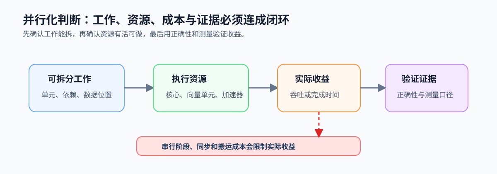
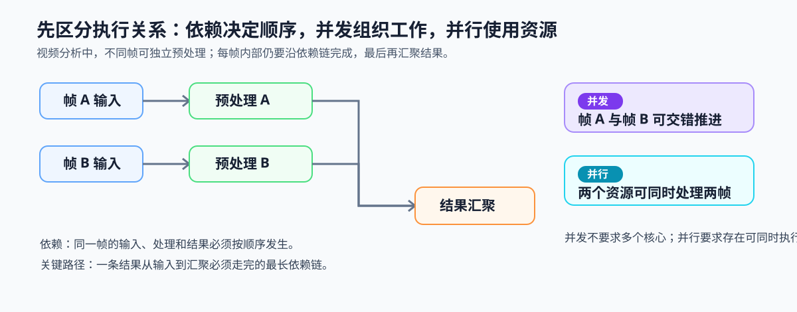

# 第1章 为什么需要并行计算

## 本章问题

本章是全书起点：当一个程序的工作量持续增长，单纯等待更高单核频率已不足以保证完成时间下降。软件需要把可独立的工作组织起来，交给多个核心、向量单元或加速器，同时确认拆分带来的同步和数据成本没有抵消收益。

本章的终点不是选择某种硬件，而是一张可复查的并行化判断卡：说明负载是否可拆、收益应按什么尺度评估、主要约束在哪里，以及怎样验证结论。

## 核心模型：工作、资源与收益如何关联

并行收益从工作负载开始，而不是从线程数开始。工作必须能拆成相对独立的单元，执行资源才有任务可做；串行阶段、同步和搬运又会限制最终收益；正确性与测量证据决定这次并行化是否可信。

*图 1-0：可拆分工作供给多个执行资源，串行与协调成本限制收益，正确性和测量口径验证最终判断。*

还需要先区分三个容易混用的词：**依赖**规定工作必须遵守的先后关系；**并发**表示多个工作在时间上交错推进，单个核心也可能做到；**并行**表示没有依赖阻塞的工作同时占用多个执行资源。依赖图中从开始到完成必须依次经过的最长链路是关键路径，它限制单次任务的最短完成时间。

*执行关系图：独立的帧可以并发组织，并在多个资源上并行处理；汇聚和顺序阶段构成关键路径，决定单次结果最早何时可返回。*

## 章节逻辑

1.1 先解释性能增长为何要求软件供给并行工作。1.2 用固定规模与规模增长两种尺度约束对收益的预期。1.3 将这些约束放回科学计算、AI、图形和数据处理等真实负载。1.4 最后把工作单元、依赖、数据路径和证据写成可复查记录。

这条路线按因果展开：没有可拆分工作就无从并行；没有收益尺度就无法解释加速；没有真实目标就无法选择证据；没有记录就无法进入后续实现与复测。

## 应用语境

视频分析流水线是本篇的主案例：多帧预处理可以拆成独立工作，采集、推理和后处理之间仍存在依赖。最小算子对照使用 [`ch09_vec_add`](../../../examples/ch09_vec_add/README.md)：输入可切分为多个元素或数据块，但任务规模较小时，调度和同步成本可能覆盖计算收益。两种语境都要求记录工作单元、串行部分、数据位置和测量口径，不能只比较一次运行时间。
