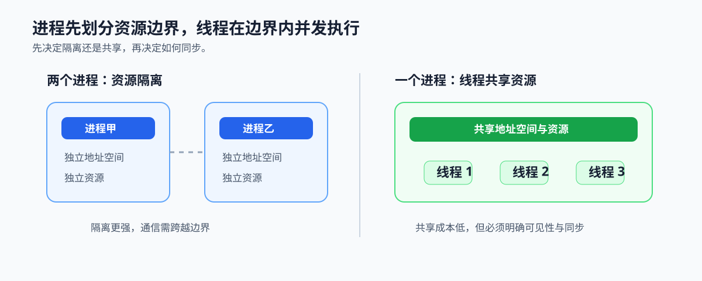
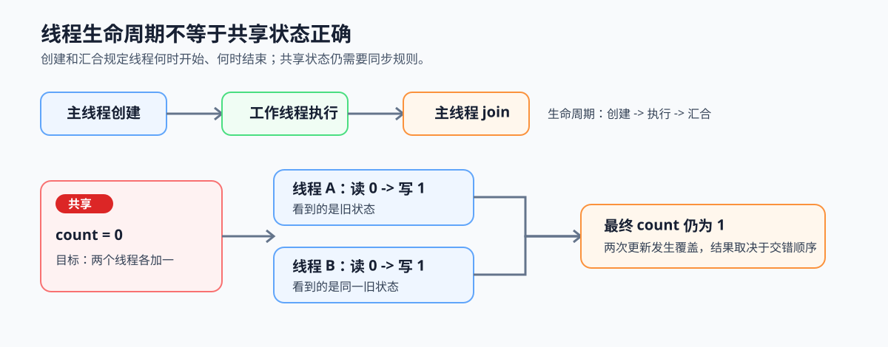

# 2.1 进程 vs 线程：并行的基本单位

## 本节导读

设想一个视频分析服务同时处理许多帧：不同租户或摄像头的任务出错后不能互相影响，但同一条流水线中的解码、预处理和推理步骤需要频繁交换中间结果。前者需要先划清故障和资源边界，后者需要在边界内高效协作。

本节先用进程和线程描述这两种边界，再判断何时单用进程、单用线程或组合使用。选定线程后，下一节会说明共享状态如何安全协作。

### 2.1.1 资源边界先决定协作方式

并发设计先回答一个问题：两组工作是否应共享地址空间。进程提供独立地址空间和资源边界；同一进程中的线程共享地址空间与大部分进程资源。这个选择决定数据交接是跨边界通信，还是进程内共享访问。

*图 2-1：进程以独立地址空间划分资源与故障边界；线程在同一进程内共享资源，因此能够直接协作。*

### 2.1.2 共享地址空间会先暴露竞态与生命周期问题

线程共享地址空间后，一个线程写入的队列、缓存或任务状态可能被另一个线程读取。操作系统仍以线程为调度执行单位，但不会替应用决定多个线程修改同一份状态的先后顺序。两个线程若都按“读取计数 -> 加一 -> 写回”修改同一计数，可能都读到旧值并覆盖对方结果；这种结果依赖交错顺序的错误叫作竞态。

主线程通常负责创建工作线程、等待它们执行完毕，再在 `join` 汇合点回收结果。创建与汇合只定义生命周期，不会自动保护中间的共享状态；因此必须先看清“谁在何时读写同一数据”，再选择同步机制。

因此，线程协作需要应用明确三件事：哪些数据允许共享，谁能修改共享状态，以及另一个线程何时可以继续读取或执行。第 2.2 节的互斥锁和条件变量正是为这些责任建立规则。

*图 2-2：两个工作线程可在同一时间读取旧计数并各自写回，结果少加一次。主线程的创建与汇合定义线程生命周期，但不能消除中间的竞态。*

### 2.1.3 隔离成本与共享成本怎样影响设计

进程把隔离、资源限制和故障恢复放在边界上，但跨进程传递数据需要序列化、通信或共享内存协议。线程让同一地址空间内的数据交换更直接，但共享范围越大，越要设计同步和生命周期规则。

任务之间没有可信的共享前提，或需要独立重启、权限与故障边界时，应优先划为不同进程。任务需要频繁交换同一批中间结果，且共享状态可以被清楚约束时，才适合在线程间协作。

### 2.1.4 用选择卡确定并发单元

把隔离需求和数据交换频率同时写下来，再选择边界。实际服务常用组合结构：进程承接用户、权限或故障边界，线程完成进程内的并发工作；选择线程的路径随即进入第 2.2 节的同步设计。第 4 章的 [`ch04_task_pool`](../../../examples/ch04_task_pool/README.md) 会把创建、等待、队列和汇合落为可运行代码。

*图 2-2：独立故障或权限边界优先采用进程；高频共享中间结果时在线程间协作；两类需求同时存在时，在进程边界内配置线程。*
