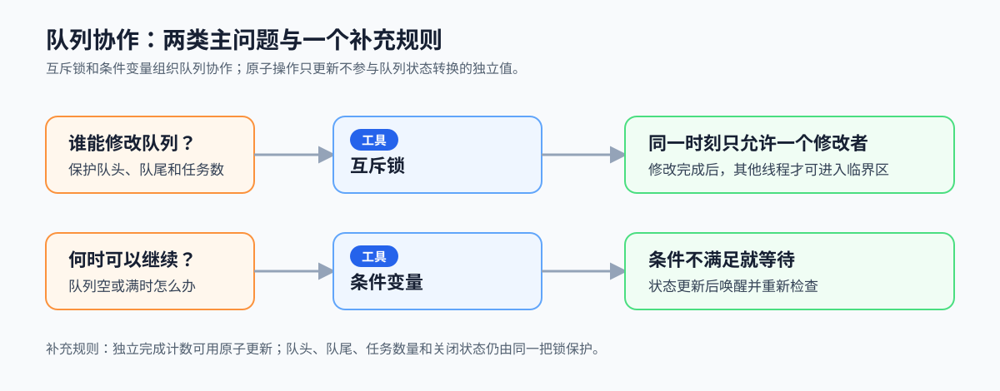
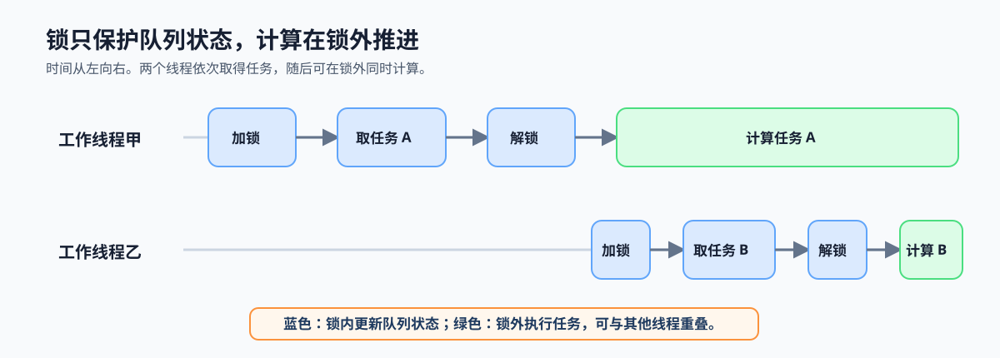

# 2.2 线程同步原语：让队列安全运行

## 本节导读

设想一个有界任务队列：生产者不断提交任务，工作线程不断取走任务。队列为空时，工作线程要等待新任务；队列已满时，生产者要等待可用位置；两者还会同时修改队头、队尾和任务数量。

读完本节，应能区分状态修改、条件等待和独立计数各自需要的同步原语，并确定锁的合理范围。第一次设计队列时，默认用锁和条件变量处理关联状态；原子操作只在已证明状态独立时才进入候选。第 2.3 节会用这些原语定义任务队列的状态、事件和关闭协议。

### 2.2.1 队列协作先区分状态与等待

队列的正常协作先处理两类问题：谁可以修改共享状态，条件不满足时谁需要等待。下图建立这两条主线的对应关系，并标出独立状态的补充处理方式。

*图 2-3：两条主线分别把“修改队列状态”交给互斥锁、把“等待队列状态变化”交给条件变量。图底部的原子操作只处理独立状态，不负责队列空满或关闭等关联状态。*

### 2.2.2 互斥与协调怎样配合

队列运行同时需要互斥与协调：

1. **互斥**
   - 避免多个线程同时修改同一份共享状态。
   - 队列中需要保护队头、队尾、任务数量和关闭状态。

2. **协调**
   - 让一个线程在条件不满足时等待，等另一个线程把条件准备好。
   - 队列为空时消费者等待生产者，队列已满时生产者等待消费者。

互斥保护共享状态，协调让线程在条件满足时继续执行。两者共同维持队列的正确推进。

锁保护共享状态，条件变量协调等待与唤醒。明确这两个职责后，下一层再决定锁需要覆盖多大范围。

### 2.2.3 为什么计算要移出临界区

同步会带来阻塞、唤醒和切换开销，因此锁只覆盖队列状态更新。临界区越短，等待锁的线程越早获得推进机会；任务取得后，计算由任务拥有者在锁外完成。

*图 2-4：锁只覆盖取任务和更新队列状态。工作线程取得任务后立即释放锁，后续计算可以与其他线程取得或计算另一任务重叠。*

### 2.2.4 把同步分工写成设计规则

同步设计先把原语和对象对应起来：一组必须共同变化的状态交给同一把锁；条件变量只等待由这组状态表达的条件；不参与关联状态转换的独立值才单独使用原子操作。对第一次实现而言，若无法证明某个值独立，就把它放回锁保护的队列状态，而不是提前改成无锁结构。这样可以在写队列协议前先确定每项状态由谁保护、每次唤醒后检查什么。

写代码前，可以先按下表确认原语分工。第 2.3 节将在此基础上定义队列状态、任务所有权和关闭后的排空规则。

| 需要处理的对象 | 同步规则 | 使用时的检查 |
|---|---|---|
| 队头、队尾、任务数量等关联状态 | 在同一把锁内修改 | 锁覆盖的对象是否需要一起保持一致 |
| 队列空、满等等待条件 | 在条件变量上等待 | 被唤醒后是否重新检查谓词 |
| 独立完成计数等单个值 | 原子更新 | 是否不参与队列状态转换 |
