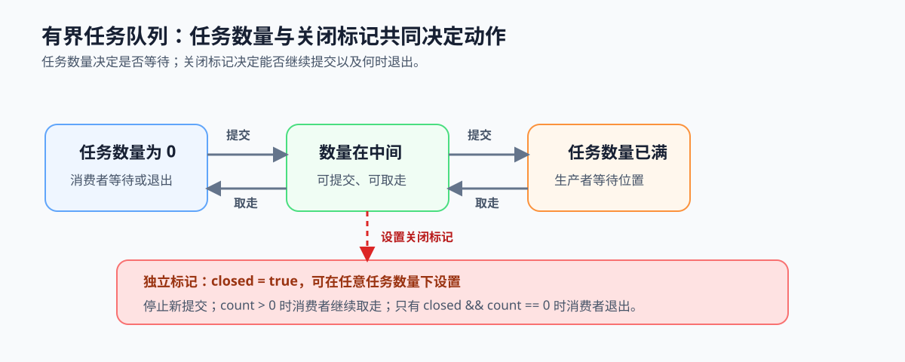
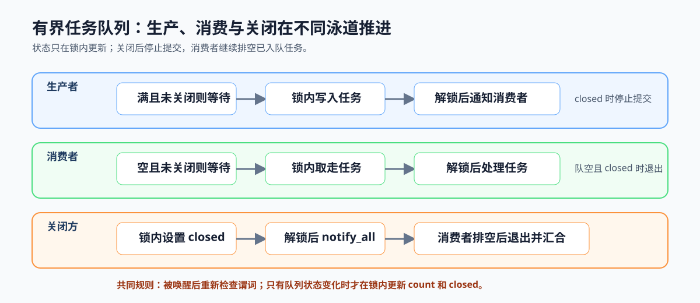

# 2.3 生产者-消费者：把同步原语放回任务队列

## 本节导读

有界任务队列把第 2.2 节的锁和条件变量放进同一条执行路径：生产者提交任务，消费者取走任务，队列在空、满和关闭时改变等待关系。

本节把这些规则写成可检查的队列协议。读完后，应能判断一次提交、消费或关闭是否保持队列状态正确；第 2.4 节再处理任务数据与就绪信号的发布顺序。

### 2.3.1 任务数量和关闭标记共同限定允许动作

有界队列至少维护任务数量、容量和关闭标记。任务数量在 `0` 到容量之间变化：为 `0` 时消费者需要等待，为容量上限时生产者需要等待。关闭标记不是另一种任务数量状态，而是独立的布尔标记；它可以在队列为空、未满或已满时设置。

设置关闭标记后，生产者不再提交新任务；消费者仍可取走已经入队的任务，只有在 `closed && count == 0` 时才退出。提交、取走和关闭因此分别改变任务数量或关闭标记，并决定操作应等待、更新状态、通知对方还是退出。



*图 2-5：任务数量决定提交或取走是否需要等待；`closed` 是可在任意任务数量下设置的独立标记。关闭后不再提交，但消费者继续排空已入队任务。*

### 2.3.2 提交、消费和关闭如何推进队列

生产者获得锁后，若队列已满且尚未关闭就在条件变量上等待；被唤醒后重新检查。若已关闭则停止提交，否则写入任务、更新任务数量、释放锁并通知等待的消费者。消费者获得锁后，若队列为空且尚未关闭就在条件变量上等待；被唤醒后重新检查。队列非空时取走一个任务、更新任务数量、释放锁并通知等待的生产者；只有队列为空且已关闭时才退出。关闭方在锁内设置关闭标记，释放锁后唤醒全部等待线程。

```text
生产者：lock -> 满且未关闭则 wait -> closed 则结束提交 -> 写入任务 -> unlock -> notify
消费者：lock -> 空且未关闭则 wait -> 非空则取走任务 -> unlock -> 在锁外计算
          空且 closed 则退出
关闭方：lock -> 设置 closed -> unlock -> notify_all -> 等待消费者排空并 join
```

被唤醒的生产者或消费者必须重新检查条件，因为其他线程可能已先改变队列状态。关闭后，生产者停止提交；消费者继续处理已入队任务，直到队列排空。

把这两类等待写成谓词，可以直接检查代码中的等待循环：

```text
生产者等待：count == capacity && !closed
消费者等待：count == 0 && !closed
消费者退出：closed && count == 0
```

`count` 是锁保护的队列任务数量，`capacity` 是固定容量，`closed` 是同一把锁保护的关闭标记。谓词为假时线程才继续推进；被唤醒不等于谓词一定变为假，因此必须回到循环重新检查。

### 2.3.3 不变量约束锁的范围与任务所有权

队列头尾、任务数量和关闭标记属于同一份队列状态，必须在同一把锁保护下修改。任务数量始终介于 `0` 和队列容量之间；提交任务要求 `!closed && count < capacity`，取任务要求 `count > 0`，退出要求 `closed && count == 0`。

消费者成功取走任务后才拥有该任务，实际计算不再占用队列锁。这一边界既保证队列状态一致，也使其他线程能继续提交或取得任务。

### 2.3.4 用生命周期检查卡验证队列协议

检查一个队列实现时，依次确认：状态修改是否在锁内，等待线程是否在循环中重新检查条件，关闭后是否拒绝新提交但继续排空已入队任务，以及 `closed && count == 0` 时是否唤醒并退出全部消费者。将这些规则填入[工作底稿的任务交接区](../workload-dossier.md#2-任务交接)后，第 4 章可用 [`ch04_task_pool`](../../../examples/ch04_task_pool/README.md) 对照代码和运行日志；第 2.4 节则继续检查任务数据是否先于就绪信号发布。



*图 2-6：提交、取走和关闭都只在锁内改变队列状态；关闭后停止提交、唤醒等待者并排空剩余任务，最后才汇合工作线程。*
