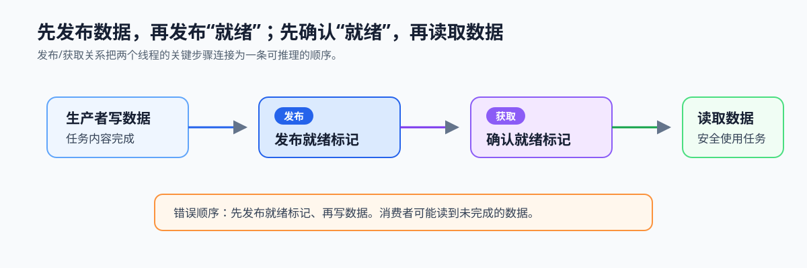
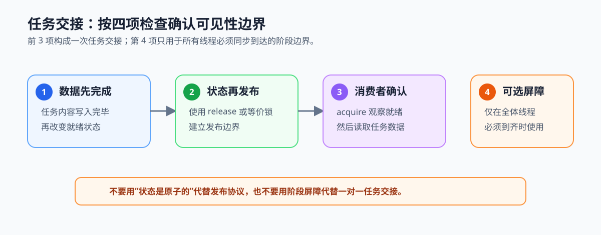

# 2.4 可见性、发布顺序与屏障

## 本节导读

生产者把任务内容写入缓冲区后，消费者还不能只凭“有人正在生产”就开始读取。它必须知道任务数据已经完成，并且自己观察到的是这次完成后的数据；否则即使队列的空、满和关闭状态正确，也可能交接到不完整任务。

本节把任务数据和“就绪”状态分开建模，说明发布/获取关系如何连接两者，并给出审查任务交接的检查卡。第一次阅读只需掌握“数据完成 -> 发布就绪 -> 确认就绪 -> 读取数据”的顺序；不要求立即手写 release/acquire 或内存屏障。下一节再讨论线程都在等待或重试时，系统为何会失去推进。

### 2.4.1 数据与就绪状态必须分开建模

任务内容和 `ready` 标记承担不同职责：前者是消费者要使用的数据，后者只说明消费者是否可以开始读取。生产者先完成任务内容，再发布 `ready`；消费者先确认 `ready`，再读取任务内容。



*图 2-7：生产者先完成数据写入，再发布“就绪”状态；消费者确认就绪后读取数据。箭头连接两个线程之间必须建立的先后关系。*

### 2.4.2 发布与获取如何建立可见顺序

锁保护的队列中，解锁、等待和重新获得锁已经提供了常见任务交接所需的同步边界。只有在不使用这类锁保护、而是让消费者直接通过原子 `ready` 标记读取任务时，才需要显式讨论发布与获取。

发布操作把“此前的数据写入已经完成”与状态更新关联起来；获取操作在观察到该状态后，才允许后续读取任务数据。两者配对后，消费者对 `ready` 的成功观察才具有“可以读取对应数据”的含义。

```text
生产者：写任务数据 -> release 发布 ready
消费者：acquire 读取 ready -> 读取任务数据
```

单独把 `ready` 写成原子变量并不自动发布关联数据；只有采用匹配的发布/获取语义，或使用已提供相同同步边界的锁和条件变量，数据与状态才形成可推理的先后关系。

### 2.4.3 原子、锁与屏障分别确定什么边界

原子操作适合独立计数器、状态标记或队列索引的单次更新，但不替任务数据自动建立发布关系。锁保护一组关联状态，并在解锁与重新获得锁之间提供同步边界；条件变量还负责等待与唤醒。对本教程前期的队列实现，优先选择这条锁保护路径；显式原子内存序留到确有无锁结构或性能需求时再深入。

内存屏障或内存序只约束读写观察顺序，不提供互斥或等待。线程集合屏障则要求一组线程都到达同一阶段后再继续，适合阶段式计算；它不能替代生产者向特定消费者交接一个任务时的 `ready` 协议。

### 2.4.4 用发布检查卡审查任务交接

审查任务交接时，先确认锁与条件变量是否已覆盖关联状态和等待；只有锁外通过 `ready` 交接数据时，再确认数据是否先于状态完成、状态是否通过匹配同步原语发布、消费者是否在确认状态后读取数据。阶段屏障不能替代任务交接协议。满足这些条件后，队列中的一次任务交接才具有明确的可见性边界。



*图 2-8：检查卡把任务交接拆为数据完成、状态发布、消费者确认和阶段同步四项，分别对应不同的同步责任。*
