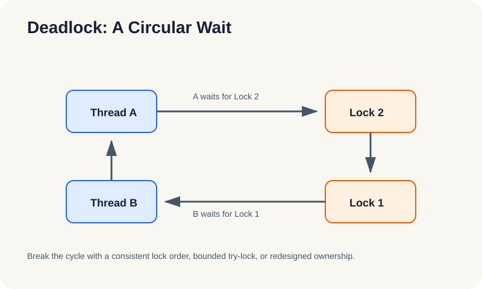
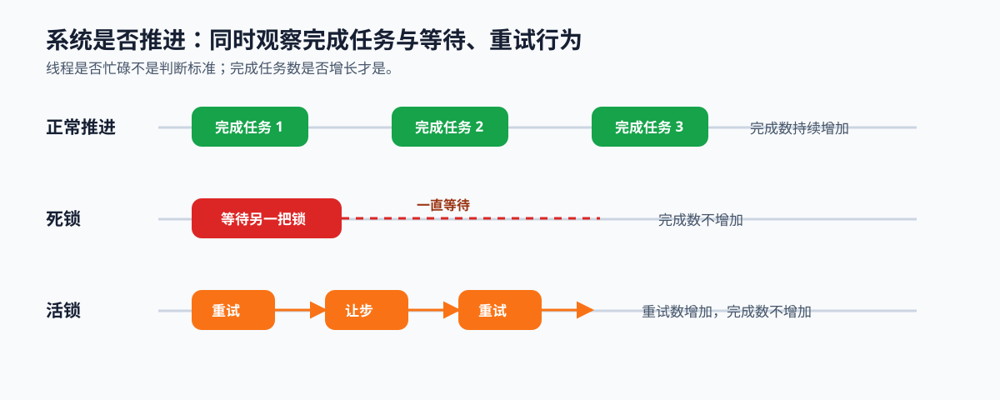

# 2.5 死锁与活锁：从正常生命周期看失败路径

## 本节导读

第 2.3 节的队列协议保证状态能按规则修改，第 2.4 节保证任务能按顺序交接，但系统仍可能无法完成任务：线程互相等待资源，或不断重试却始终没有完成有效工作。

本节区分死锁和活锁，说明它们各自的规避与观测方法。读完后，应能用锁顺序、完成任务数和重试记录判断系统是否仍在推进；第 3 章将把这些执行关系抽象为并行模式。

### 2.5.1 等待图先区分死锁与活锁

死锁中，线程持有一部分资源并等待另一部分资源，依赖关系形成闭环，所有参与者都停在等待点。活锁中，线程仍在让步、重试或重新竞争资源，但完成任务数没有增加；它看起来在运行，实际没有推进。

*图 2-9：线程甲和线程乙分别持有一把锁并等待对方持有的锁，依赖形成闭环，任何一方都无法继续。*

### 2.5.2 固定锁顺序如何破除循环等待

涉及多把锁时，为所有线程规定同一获取顺序。例如始终先获取编号较小的锁，再获取编号较大的锁，就不会出现两个线程各持一把锁、再反向等待另一把锁的环。

固定顺序只处理多锁造成的循环等待；它不解决长时间持锁、任务未通知或无限重试等其他失败路径。发生阻塞时，先画出线程到资源的等待图，再判断是否存在环。

### 2.5.3 重试为何可能没有有效推进

活锁的危险在于线程没有阻塞，却反复执行同一轮让步和重试。处理这类路径时，需要为重试加入退避、随机抖动、次数上限或超时，并同时记录重试次数和完成任务数；只有完成任务数增长才表示系统确实推进。

*图 2-10：正常路径的完成任务数持续增加；死锁停在等待状态；活锁的重试持续发生，但完成任务数保持不变。*

### 2.5.4 用推进检查卡定位失败路径

排查任务队列时，按下表保留等待图、锁顺序和运行日志。第 4 章的线程池实现可据此补充对应证据。这些检查把第 2 章收束为五个动作：划定共享边界、保护队列状态、协调等待与唤醒、建立发布顺序、验证系统持续推进。第 3 章将用数据并行、任务并行和流水线描述这些动作如何组织成不同的执行模式。

| 观察对象 | 要记录的证据 | 失败信号 |
|---|---|---|
| 等待图 | 线程等待的资源与持有关系 | 依赖形成环 |
| 锁顺序 | 多锁获取序列 | 不同路径顺序不一致 |
| 完成任务数 | 固定时间窗口内的完成量 | 长时间不增长 |
| 重试与关闭 | 重试次数、超时、唤醒和汇合日志 | 重试增长或线程无法退出 |
