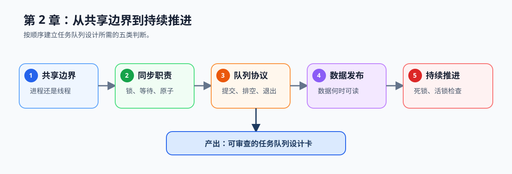

# 第2章 操作系统层面的并行基础

## 章节定位与总览图

本章解决视频分析流水线中的共享任务如何安全执行：先确定采集、队列和工作线程的共享边界，再定义状态修改、等待、数据交接、关闭和持续推进的规则。它承接第 1 章的并行化判断，为第 3 章的并行模式和第 4 章的线程池实现提供执行时序基础。

*学习路线图：从共享边界开始，依次建立同步原语、队列协议、发布顺序和推进检查，最终产出一份可审查的任务队列设计。*

## 前置基础

- 已理解第 1 章中的任务粒度、串行比例和验证口径。
- 能阅读基础的 C/C++ 伪代码；本章不要求先具备线程库 API 经验。

## 学习路径

1. 先读 [本章导语](./intro.md)，建立共享任务队列的整体模型。
2. [2.1 进程 vs 线程](./01-process-vs-thread.md)：确定任务应隔离还是共享地址空间，并理解共享状态为何会发生竞态。
3. [2.2 线程同步原语](./02-synchronization-primitives.md)：明确锁、条件变量和原子操作的职责。
4. [2.3 生产者-消费者](./03-producer-consumer.md)：将原语组织为提交、消费、关闭和排空协议。完整 Part01 路线阅读；Task 1 可延后。
5. [2.4 可见性、发布顺序与屏障](./04-visibility-and-barriers.md)：确认任务数据何时可被消费者读取。完整 Part01 路线阅读；Task 1 可延后。
6. [2.5 死锁与活锁](./05-deadlock-and-livelock.md)：用等待图、完成任务数和重试记录检查系统是否持续推进。完整 Part01 路线阅读；Task 1 可延后。

## 配套实践

- 在第 1 章[工作负载记录卡](../../learning-tools/workload-record-card.md#1-工作与收益)的帧预处理记录上，补充采集、共享队列、工作线程和关闭方的边界；需要查看可运行实现时，进入 [`ch04_task_pool`](../../../examples/ch04_task_pool/README.md)。产出任务队列设计部分，写明状态变量、等待谓词、发布顺序、排空规则和持续推进证据。
