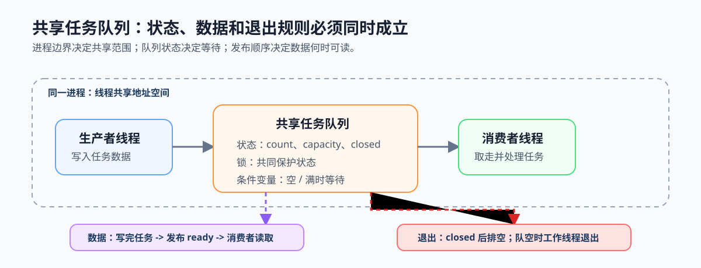

# 第2章 操作系统层面的并行基础

## 本章问题

第 1 章解决“任务是否值得并行”，但工作被拆开后仍需要安全地交给多个执行流。以视频分析流水线为例，采集线程持续提交帧预处理或推理任务，多个工作线程从同一队列取走任务；如果边界、状态、数据交接和退出顺序没有写清，系统可能重复处理、读取半成品任务，或在关闭时永久等待。

本章的终点是一份可审查的任务队列设计：能够说明任务在哪个边界内共享、谁修改队列、何时等待、何时读取数据、关闭后如何排空，以及怎样确认系统仍在推进。

## 核心模型：共享任务队列如何成立

一个最小队列模型同时包含三个关系：进程边界决定哪些工作可以共享地址空间，队列状态决定提交者和消费者谁需要等待，任务数据与就绪状态决定消费者何时可以读取。初学者先用锁和条件变量建立这些关联状态的正确协议；原子发布与显式内存序只用于理解锁外任务交接为何仍需顺序。关闭标记独立于任务数量，关闭后停止提交但继续排空已入队任务。

*图 2-0：生产者和消费者在同一进程内通过共享队列协作。锁和条件变量保护队列状态与等待关系；任务数据完成并发布就绪后才能被读取；关闭后按排空规则退出。*

## 章节逻辑

2.1 先确定进程与线程边界，避免在不该共享的位置直接引入同步。2.2 再为关联状态、等待条件和独立计数选择正确原语。2.3 把这些原语写成队列的提交、消费、关闭和排空协议。2.4 处理队列之外的另一条关系：任务数据怎样先于就绪状态被观察。2.5 最后用等待图、完成任务数和重试记录验证系统没有停在失败路径。

这条路线按依赖展开：没有共享边界就无从定义同步对象；没有同步职责就无从写协议；没有发布顺序和推进证据，协议也无法证明任务真的被正确完成。

## 应用语境

视频分析流水线是本章的典型语境：采集端、共享队列、工作线程和关闭方分别承担不同角色。每条协作规则都应能落到一个状态变量、一个等待条件或一条日志记录，而不能只靠一次运行成功来判断正确性。
