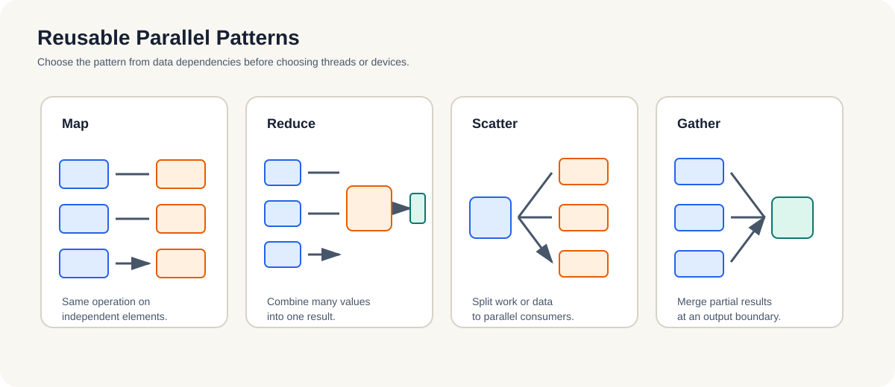
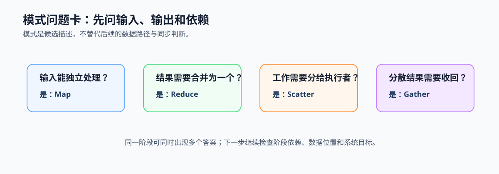

# 3.1 基本并行模式：用数据关系描述工作

## 本节导读

视频分析服务接收一批帧后，可以对每帧执行相同的预处理，也可能把每帧的检测数量合并成一个统计值，还需要把帧分给工作者并把结果收回。这些动作看似不同，但都可以用少数稳定的模式描述。

本节用 Map、Reduce、Scatter 和 Gather 建立描述工作关系的共同语言。读完后，应能从输入、输出和依赖识别基本模式；下一节再讨论任务并行与数据并行如何在同一系统中组合。

### 3.1.1 输入与输出先决定模式关系

Map 把同一操作作用于多个相对独立的输入；Reduce 把多个部分结果合并为一个值；Scatter 把工作或数据分给多个执行者；Gather 把分散结果收回到统一输出边界。它们描述的是数据与结果关系，不是某种固定硬件或 API。

*图 3-1：Map 处理独立元素，Reduce 合并部分结果，Scatter 分发工作或数据，Gather 汇聚结果。先识别输入输出关系，再讨论执行位置。*

### 3.1.2 每种模式对应不同的同步点

Map 的主要前提是元素间依赖少；Reduce 需要定义部分结果何时、按什么规则合并；Scatter 需要确认分发粒度与数据位置；Gather 需要确认结果何时完整并写回。模式名称的价值在于暴露这些同步点和数据边界。

视频服务中，帧内 resize 可视为 Map；一批帧的总检测数可视为 Reduce；把帧送入多个工作者是 Scatter；把各帧结果整理成响应是 Gather。

### 3.1.3 模式不替代依赖和数据路径判断

同一个负载可同时包含多种模式。Map 阶段仍可能受数据搬运限制，Reduce 阶段可能成为汇合瓶颈，Scatter 与 Gather 可能引入队列等待或结果顺序约束。因此，识别模式后仍要记录谁依赖谁、数据放在哪里以及合并是否需要等待。

### 3.1.4 用模式问题卡观察真实负载

分析一个阶段时，依次问：输入是否能独立处理，结果是否需要合并，工作是否要分发，结果是否要汇聚。回答这些问题后，才能进入第 3.2 节判断是阶段之间的任务并行，还是阶段内部的数据并行。

*图 3-2：模式问题卡将输入、输出与依赖翻译为 Map、Reduce、Scatter 或 Gather 的候选描述，再交给后续小节判断组合方式与执行位置。*
