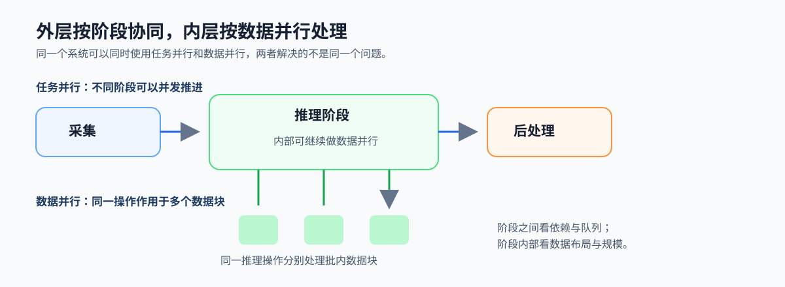

# 3.2 任务并行与数据并行：外层阶段，内层数据

## 本节导读

视频分析服务包含采集、推理、后处理等不同阶段，同时推理阶段内部又要对多帧或多个数据块执行相同计算。只用“任务并行”或“数据并行”描述整个系统，都会遗漏另一层的依赖与机会。

本节区分阶段之间的任务并行和阶段内部的数据并行。读完后，应能指出一个系统的控制流由谁推进、数据流在哪里放大，并判断哪一层的约束更主导后续设计。

### 3.2.1 阶段协同与同构计算可以嵌套

任务并行把采集、推理、后处理等不同职责安排为可重叠的阶段；数据并行把某一阶段中的同类数据块交给多个执行单元处理。前者主要组织控制流和队列节奏，后者主要放大同构计算的规模。

*图 3-3：任务并行把系统拆成前后相接的阶段；数据并行在某一阶段内部把同类数据分给多个执行单元。两者常在同一系统中嵌套。*

### 3.2.2 控制流和数据流分别暴露什么问题

任务并行首先关注阶段依赖、队列边界、背压和哪一阶段限制整体速率。数据并行首先关注数据是否规则、分块是否均衡、数据布局是否连续，以及合并结果是否增加同步。

在视频服务中，采集到推理之间的帧队列属于控制流边界；推理阶段把 batch 中的帧分块计算属于数据流放大。两层需要分别观察，不能只因使用多个线程或设备就认为同一种并行在起作用。

### 3.2.3 组合后仍要处理交界处的约束

外层阶段速率不匹配会让队列增长或设备空闲；内层分块不均会让部分执行单元提前结束。阶段之间的数据交接还要遵守第 2 章的状态、发布和关闭规则，阶段内部的计算则要回到粒度、搬运和归约成本。

因此，组合模式并不自动提高性能，关键是让阶段边界与数据切分的粒度相互匹配。

### 3.2.4 用双层检查卡判断主导约束

先问系统是否主要卡在阶段依赖与队列节奏，再问某个计算阶段是否存在足够规则的数据并行。主导约束决定先优化控制面还是先优化计算面；第 3.3 节会进一步用吞吐与延迟判断这种取舍的系统目标。

*图 3-4：阶段依赖、队列和背压属于任务并行检查；分块、布局和归约属于数据并行检查。先定位主导层，再选择优化动作。*
