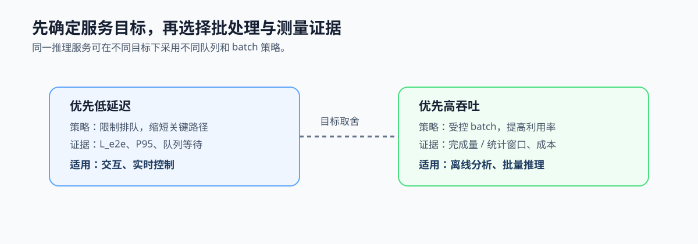

# 3.3 吞吐量与延迟：先确定系统要优化什么

## 本节导读

同一个视频分析服务既可以让单帧尽快返回，也可以积累多帧后批量推理以提高单位时间完成量。两种安排使用的计算资源可能相同，但排队、batch 和调度策略不同。

本节区分吞吐与端到端延迟，并将它们连接到批处理与队列决策。读完后，应能说明一个服务的首要目标，以及为此需要记录哪些时间和完成量证据。

### 3.3.1 单请求路径和批处理路径关注不同量

延迟关注一个请求从输入到返回经历多久；吞吐关注一个时间窗口内完成多少请求、帧或样本。单请求路径通常减少排队和批量等待，批处理路径则让设备一次处理更多工作。


*图 3-5：单请求路径关注从输入到返回的总时间；批处理让设备一次处理更多工作，通常提高吞吐，但会引入排队等待。*

### 3.3.2 用完成量和阶段时间定义测量对象

统计窗口内的吞吐可写为：

```text
Throughput = N_completed / T_window
```

`N_completed` 是统计窗口内完成的工作项数，单位可以是 frame、sample 或 token；`T_window` 是窗口时长，单位为 s；吞吐的单位相应为 frame/s、sample/s 或 token/s。例如 10 秒完成 500 帧时，吞吐为 50 frame/s。预热阶段不能混入统计窗口，完整定义见[附录 E：公式与指标表](../../appendix/E-formulas-and-metrics.md)。

单请求的端到端延迟可按阶段边界分解：

```text
L_e2e = L_queue + L_prepare + L_transfer + L_compute + L_postprocess
```

`L_e2e` 是同一请求从进入到返回的总延迟；各项分别是排队、准备、传输、计算和后处理时间，通常以 ms 记录。阶段存在异步重叠时，不能直接把各阶段平均值相加；必须使用同一请求的时间戳和明确阶段边界。

### 3.3.3 批处理提高吞吐也会改变等待时间

扩大 batch 往往让一次计算处理更多工作，从而提高设备利用率和吞吐；但请求需要等待其他工作项凑成批次，`L_queue` 可能上升。在线对话和实时控制通常优先限制端到端延迟，离线分析和批量推理通常优先提高吞吐。

因此，选择 batch、队列深度和并发数时，应先明确服务目标和可接受的延迟上限，而不是只追求峰值算力或最大 batch。

### 3.3.4 用目标卡选择调度与验证证据

先标记服务优先保证单请求响应还是单位时间完成量，再记录对应的队列等待、端到端延迟或统计窗口完成量。第 3.4 节将在此基础上把模式和目标映射为候选执行位置，而不是直接按设备名称选型。



*图 3-6：低延迟路径优先缩短排队和关键路径；高吞吐路径允许受控批处理，并以统计窗口完成量验证。*
