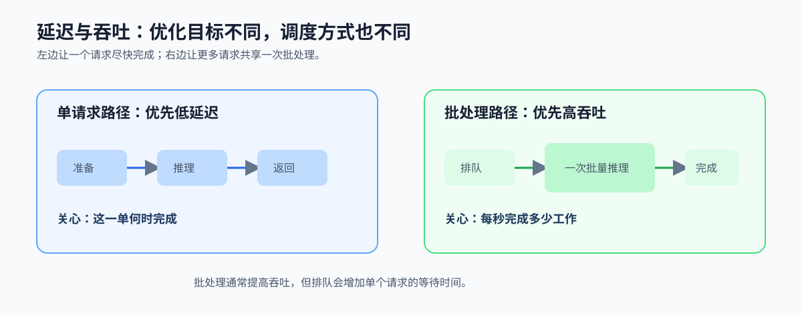

# 3.3 吞吐量 vs 延迟（📋 产品经理重点）

- **延迟**：单个请求多快完成。**吞吐量**：单位时间处理多少。
- 加速器优化吞吐，常以牺牲单次延迟为代价；选型时要分清你真正要的是哪一个。

*图 3-2：单请求路径关注从输入到返回的总时间；批处理让设备一次处理更多工作，通常提高吞吐，但会引入排队等待。云端和边缘端因此常选择不同的调度策略。*

这组概念非常容易被混淆，但它们对应的是两种完全不同的系统目标：

- **低延迟**：更关心“这一单什么时候完成”，常见于交互式请求、实时控制、交互 UI。
- **高吞吐**：更关心“单位时间能做多少”，常见于批处理、训练、离线推理、视频分析。

并行系统经常会出现一个现象：

- 单次任务拆得越多，吞吐可能越高。
- 但拆分、排队、同步、缓冲会让单次延迟变大。

所以选型时不能只看峰值算力，还要看调度、队列深度和流水线长度。  
这也是为什么同样是加速器，有的更适合批量处理，有的更适合交互式推理。

如果把这节放到大模型场景里理解，会更直观：

- 在线对话更关心首 token 延迟和流式输出体验。
- 离线批处理更关心总吞吐和单位成本。
- 推理服务往往要在延迟、吞吐和显存占用之间折中。

这意味着架构选择不只是“能不能并行”，而是“并行之后，到底是在优化哪一个系统目标”。

**小结**
吞吐和延迟不是同一个问题。前者强调单位时间做多少，后者强调单次请求多久完成。把这两个目标分清楚，很多硬件和架构选择才不会方向跑偏。
