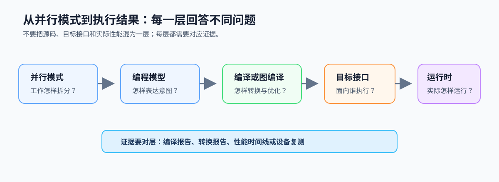
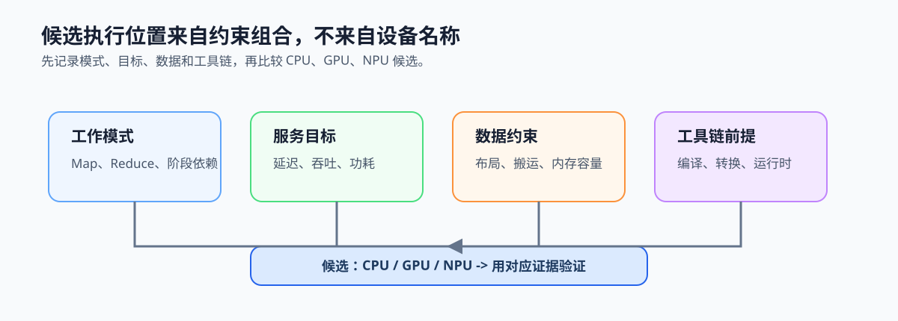

# 3.4 从模式到候选执行位置：先看约束，再看设备

## 本节导读

视频分析服务的帧内推理可能适合高并发计算，采集与后处理可能更依赖低延迟控制，模型部署还会受到输入格式、内存和运行时支持的限制。仅凭“这是 AI 任务”或“有 GPU/NPU”无法给出可靠选择。

本节把模式、服务目标和数据约束翻译成候选执行位置。读完后，应能说明 CPU、GPU、NPU 各自为何进入候选集，以及需要什么证据淘汰或保留候选；第 3.5 节再把判断写成记录卡。

### 3.4.1 模式先缩小候选执行位置

规则 Map 型计算、连续数据布局和可批处理工作通常值得评估 SIMD、GPU 或 NPU；阶段依赖、队列调度和复杂分支通常保留 Host CPU 的控制职责；Reduce 则需额外检查合并成本与同步边界。模式不直接决定设备，但能先排除明显不匹配的候选。

*图 3-7：模式描述工作怎样拆分，编程模型表达意图，编译或图编译生成目标工件，运行时负责实际提交与执行。候选硬件只是这条链路中的一个位置。*

### 3.4.2 CPU、GPU 与 NPU分别带来什么约束

CPU 适合复杂控制流、服务调度和低延迟收口，也可通过多线程或 SIMD 承担规则计算。GPU 候选通常来自大量同构计算、批处理和规则数据布局，但需要检查 Host 供给、传输和 kernel 启动成本。NPU 候选通常来自稳定的模型图和推理数据流，但需要检查模型转换、量化、算子覆盖和运行时部署约束。

这些是候选理由，不是性能承诺。实际选择仍取决于输入规模、延迟目标、内存位置和工具链是否能形成可验证闭环。

### 3.4.3 不要把模式、接口和运行结果混为一层

模式说明工作关系；[OpenMP](../../part02-host-cpu/chapter05-openmp/README.md)、[CUDA](../../part03-coprocessor/chapter09-gpu-cuda/README.md) 或模型图等表达接口说明如何提交工作；编译器、图编译器和运行时决定工作怎样抵达设备并被执行。性能证据也要对层：可以是 CPU 编译报告、GPU 时间线，或 NPU 转换和运行时报告。

本节只建立这种分层判断。CPU 指令扩展、CUDA 编译链和 NPU 图工件将在[第 6 章](../../part02-host-cpu/chapter06-simd/README.md)、[第 9 章](../../part03-coprocessor/chapter09-gpu-cuda/README.md)、[第 11 章](../../part03-coprocessor/chapter11-npu-tpu/README.md)结合实际工具分别展开。

### 3.4.4 用候选卡保留选择依据

为每个候选执行位置记录：它匹配的工作模式、主要数据约束、服务目标、工具链前提和需要验证的证据。这样在第 3.5 节填写模式选择记录卡时，设备名称只是待验证的候选，而不是替代前面判断的结论。

*图 3-8：模式、目标、数据与工具链共同决定候选执行位置；CPU、GPU、NPU 均须用对应证据验证，而非由任务名称直接决定。*
