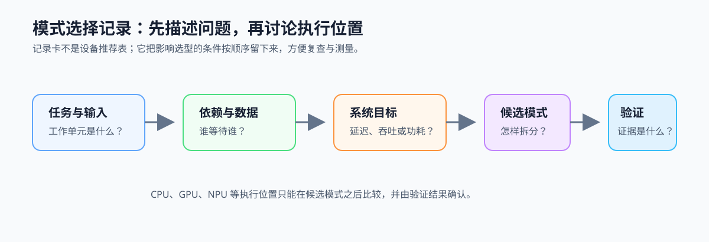
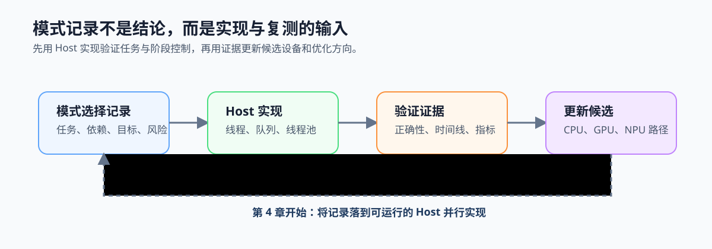

# 3.5 模式选择记录卡：把模式判断交给后续实现

## 本节导读

前三节分别识别了输入输出模式、任务与数据并行的组合，以及吞吐与延迟目标；3.4 又把这些条件转为候选执行位置。它们应补入前两章已经开始的视频分析流水线工作负载记录卡，才能形成可讨论、可复查的记录，并进入第 4 章的线程池实现。

本节补齐工作负载记录卡的模式选择部分。读完后，应能先描述视频分析流水线，再将同一套字段迁移到 [`ch09_vec_add`](../../../examples/ch09_vec_add/README.md) 或 [`ch14_attention_pipeline`](../../../examples/ch14_attention_pipeline/README.md)，并把候选模式与验证证据交给后续实现和测量。

### 3.5.1 记录从任务、依赖和目标开始

模式选择先记录负载与输入、独立工作单元、前后依赖、共享数据和服务目标。候选模式与执行位置只能建立在这些事实之上，不能由设备名称或峰值算力直接决定。



*图 3-9：记录从任务与输入开始，依次写清依赖、目标、候选模式和验证证据。设备名称只能作为候选执行位置，不能替代前面的判断。*

### 3.5.2 候选模式需要对应具体约束

视频分析流水线具有流水结构，但瓶颈可能位于采集、推理或后处理；帧内预处理又常具有 Map 结构。作为迁移对照，`vec_add` 具有 Map 结构，但小输入可能仍适合 CPU 参考路径；LLM 推理还需区分批处理、请求排队和 prefill/decode 的不同目标。工作负载记录卡的作用是让这些差异显式出现。

因此，每个候选模式都要连回具体的工作单元、依赖、数据位置和系统目标。

### 3.5.3 验证证据决定候选能否保留

候选模式和执行位置必须给出验证方式：正确性参考、编译或转换报告、队列时间线、统计窗口吞吐或端到端延迟。若证据无法说明主要约束是否改善，候选仍只是猜测。

记录时可保留以下字段；完整模板见[工作负载记录卡的模式与候选区](../../learning-tools/workload-record-card.md#3-模式与候选)：

```text
负载与输入：
独立工作单元：
依赖、同步点与数据位置：
首要目标：延迟 / 吞吐 / 成本 / 功耗
候选模式与候选执行位置：
当前最大风险：串行 / 同步 / 搬运 / 负载不均 / 部署
正确性参考与需要验证的证据：
```

### 3.5.4 把记录卡交给 Host 实现与复测

完成记录后，先进入[第 4 章：CPU 多线程](../../part02-host-cpu/chapter04-cpu-multithreading/README.md)，用线程、队列或线程池验证任务与阶段控制；再在后续 CPU、GPU、NPU 章节验证具体执行位置。工作负载记录卡会随着证据更新，而不是在第一次选择硬件时冻结。



*图 3-10：模式记录先生成可验证的 Host 实现，再根据正确性、时间线和性能证据更新候选，最后进入具体设备章节。*
