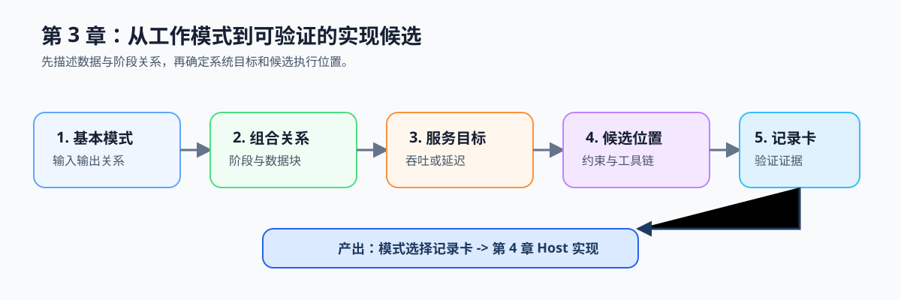

# 第3章 并行模式入门

## 章节定位与总览图

本章把第 1 章的性能判断和第 2 章的并发正确性翻译成可复用的模式语言：工作如何拆分、阶段如何协同、服务应优先吞吐还是延迟，以及哪些执行位置值得验证。它是第 4 章 Host 并行实现的直接设计输入。

*学习路线图：从基本模式开始，依次判断组合关系、系统目标和候选执行位置，最终形成可交给 Host 实现的模式选择记录卡。*

## 前置基础

- 已理解第 1 章的性能约束、测量口径和并行化判断卡。
- 已理解第 2 章的共享状态、等待、发布顺序和关闭边界。

## 学习路径

1. 先读 [本章导语](./intro.md)，建立模式作为中间语言的整体模型。
2. [3.1 基本并行模式](./01-basic-parallel-modes.md)：从输入输出与依赖识别 Map、Reduce、Scatter、Gather。
3. [3.2 任务并行与数据并行](./02-task-vs-data-parallel.md)：区分外层阶段协同与内层同构计算。
4. [3.3 吞吐量与延迟](./03-throughput-vs-latency.md)：确定服务目标、批处理与测量证据。
5. [3.4 从模式到候选执行位置](./04-hardware-mapping.md)：记录 CPU、GPU、NPU 的候选理由与验证前提。
6. [3.5 模式选择记录卡](./05-chapter-role.md)：形成可交给第 4 章实现与复测的设计记录。

## 配套实践

- 在前两章的[视频分析流水线工作负载记录卡](../../learning-tools/workload-record-card.md#3-模式与候选)上，补充阶段依赖、帧内数据切分、吞吐/延迟目标、候选执行位置和验证证据；产出模式选择部分，列出同步点、主要约束和复测证据。[`ch09_vec_add`](../../../examples/ch09_vec_add/README.md) 和 [`ch14_attention_pipeline`](../../../examples/ch14_attention_pipeline/README.md) 只用于迁移对照。
