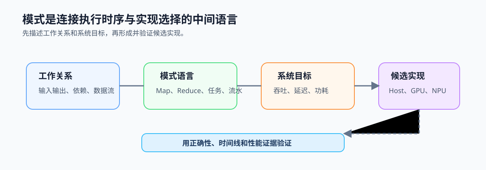

# 第3章 并行模式入门

## 本章问题

第 1 章已经判断一个负载是否值得并行，第 2 章已经规定共享状态怎样安全协作，但这些规则仍缺少一层可跨硬件复用的描述：哪些输入可以独立处理，哪些结果必须合并，哪些阶段可以重叠，以及服务到底优先完成单个请求还是单位时间完成更多工作。

本章的终点是一张模式选择记录卡：它将任务关系、系统目标和候选执行位置写成可复查依据，并交给第 4 章的 Host 实现验证。

## 核心模型：模式连接工作关系与实现选择

模式位于线程与设备之间：Map、Reduce、Scatter、Gather 描述输入输出关系；任务并行和数据并行描述阶段与数据块如何协同；吞吐与延迟明确服务目标；这些判断共同缩小 CPU、GPU、NPU 等候选执行位置。

*图 3-0：模式把工作关系和系统目标翻译为可验证的候选实现。模式不等于设备选择，候选必须通过正确性、时间线或性能证据复测。*

## 章节逻辑

3.1 先用输入输出关系建立基本模式。3.2 再区分阶段之间的任务并行和阶段内部的数据并行。3.3 用吞吐与延迟决定调度目标。3.4 把模式、目标、数据和工具链约束转为候选执行位置。3.5 最后将这些判断收束为记录卡。

这条路线避免从设备名称倒推设计：先理解工作关系，再选择目标和候选，最后以证据验证。

## 应用语境

视频分析服务提供了本章的典型语境：采集、推理和后处理构成任务并行，推理内部又可能按 batch 或帧块形成数据并行。服务目标决定应观察队列等待、端到端延迟还是统计窗口完成量。

模式应解释实际依赖与数据流，而不是给系统贴上唯一标签。
