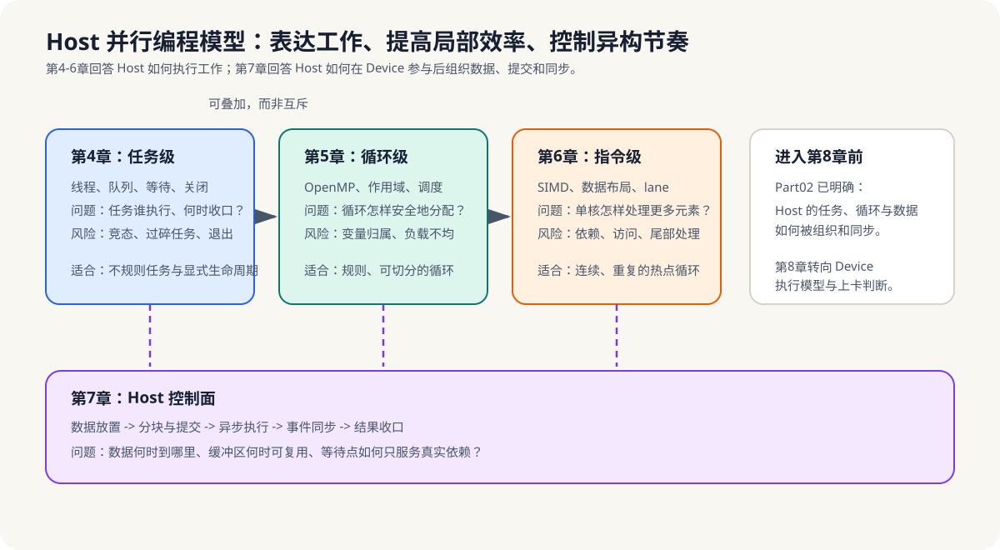

# 第二篇：Host 并行编程模型与控制面

> 目标：说明 Host 如何表达工作、分配执行资源、提高局部执行效率，并在异构系统中组织数据、提交与同步。约60页。

*图 2-0：第4-6章分别处理任务、循环和指令级并行，它们可以叠加；第7章不再引入新的 CPU API，而是把这些能力放回数据移动、异步提交和同步收口的控制面。*

本篇不是完整 CPU 架构或操作系统课程。它只保留异构并行所需的 Host 侧模型：任务生命周期、循环工作划分、向量化条件，以及跨 Host/Device 边界的数据与同步决策。

这一篇的分工是：

- 第4章：线程创建、同步和线程池，Host 如何承载任务。
- 第5章：OpenMP，Host 如何把规则循环划成并行工作。
- 第6章：SIMD，Host 如何改善数据布局与局部执行效率。
- 第7章：Host/Device 协同，数据与同步如何跨过设备边界。

## 本篇章节

- [第4章 Host 任务与多线程](chapter04-cpu-multithreading/README.md)
- [第5章 Host 数据并行：OpenMP](chapter05-openmp/README.md)
- [第6章 Host 执行效率：SIMD](chapter06-simd/README.md)
- [第7章 Host-Device 协同](chapter07-cpu-in-hetero/README.md)

## 阅读路线

- **完整概念路线**：第4章 -> 第5章 -> 第6章 -> 第7章。依次建立任务级、循环级、指令级并行，再进入 Host 控制面。
- **按问题查阅**：不规则任务与关闭协议看第4章；规则循环和数据作用域看第5章；热点循环和向量化看第6章；数据放置、异步提交和同步边界看第7章。

> 📋 产品经理重点看第7章，它解释了 Host 为什么是系统控制面，而不是另一颗“较慢的算力芯片”。

## 范围边界

本篇不替代完整的 CPU 架构、操作系统或 C/C++ 并发课程；不要求实现通用线程库。它只建立后续异构系统需要的 Host 侧工作表达、局部效率和控制面决策。
