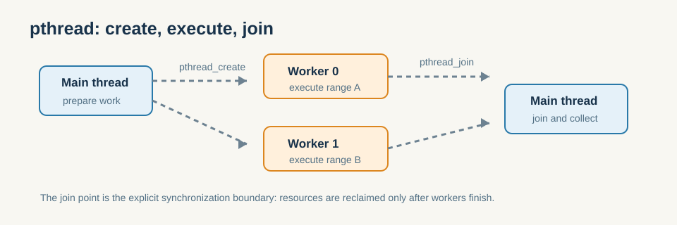

# 4.1 POSIX 线程（pthread）入门

pthread 是最底层的线程接口，它的价值不在于“更好用”，而在于它把线程创建、传参与回收这些责任完全暴露出来。

- 创建（`pthread_create`）、等待（`pthread_join`）、传参与返回值。
- 线程函数签名与共享数据的传递方式。

*图 4-1：主线程显式创建工作线程，再在 `pthread_join` 处汇合并回收结果；汇合点也是关键同步边界。*

### 4.1.1 线程函数的最小骨架

pthread 的最小价值，不在于接口本身多复杂，而在于它把“把一段函数交给另一个执行单元运行”这件事显式化了。你需要自己决定：

- 哪些数据由主线程准备；
- 哪些数据在工作线程里只读；
- 哪些结果需要回传；
- 主线程什么时候继续、什么时候等待。

这也是为什么 pthread 非常适合拿来理解并行的本质：它几乎不给你抽象，所有责任都要自己显式处理。

从工程视角看，pthread 还有一个重要作用：它逼着你明确线程入口函数、输入参数和返回结果的边界。这个边界一旦模糊，后面无论是线程池，还是更高层的并行抽象，都会把同样的复杂度继续放大。

### 4.1.2 手动切分任务时最容易出的问题

如果把 `vec_add` 这类任务手动切成若干段交给多个线程，最常见的问题不是“线程起不来”，而是下面这些：

- 切分边界算错，导致重复计算或漏算。
- 共享数组访问方式不明确，导致数据竞争。
- 主线程提前退出，工作线程还没完成。
- 线程结果需要合并，却没有统一的同步点。

所以 pthread 的教学意义，其实是让读者先意识到：并行不是“开几个线程”这么简单，而是“任务切分、同步和资源回收”必须一起设计。

如果把它放到第2章的框架里看，pthread 解决的是“如何显式启动一个执行流并把结果收回来”，而不是“怎样自动并行化”。这也是它适合拿来做底层理解、但不一定适合直接作为大规模业务代码入口的原因。

这一节读完后，可以形成一个判断：pthread 提供最直接的控制权，但要付出更高的复杂度；如果更在意低侵入和可维护性，就继续看第5章的 OpenMP。

**小结**
pthread 把线程生命周期完全暴露出来，因此最适合用来理解“任务如何交给另一个执行单元运行、结果如何回收”。看懂这里之后，再看线程池和 OpenMP，就能更清楚它们是在替你封装哪些重复工作。
