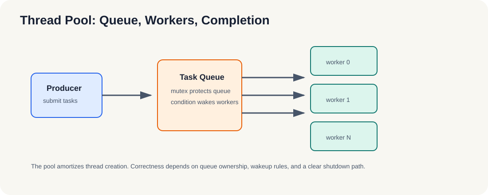

# 4.2 线程池设计与实现（🔬 进阶）

线程池的目标不是“让线程变多”，而是让线程生命周期和任务生命周期解耦。

- 为什么要池化：避免频繁创建/销毁线程的开销。
- 任务队列 + 工作线程模型，条件变量驱动。

*图 4-2：生产者只负责提交任务，队列在互斥保护下保存待处理工作，条件变量负责唤醒工作线程。线程池的正确性取决于队列所有权、唤醒规则和退出协议。*

### 4.2.1 线程池为什么更像工程方案

如果 pthread 对应的是“最原始的线程控制”，线程池对应的就是“更像系统服务的线程管理方式”。它的核心价值在于：

- 把线程创建和任务执行解耦；
- 把任务分发和工作线程唤醒解耦；
- 把短任务的调度成本摊薄到线程生命周期中。

这就是为什么高并发服务、批处理任务、异步工作队列几乎都会走线程池，而不是每次来一个任务就新建一个线程。

更准确地说，线程池的价值是把“线程管理”从业务逻辑里剥离出去。业务只负责投递任务，线程池负责调度、等待、唤醒和退出，二者通过队列连接。

### 4.2.2 线程池的三个核心部件

一个最简线程池通常由三部分组成：

1. **任务队列**
   - 保存待处理任务。
   - 决定任务排队顺序和等待策略。

2. **工作线程**
   - 从队列中取任务。
   - 执行任务逻辑。
   - 在空闲时等待条件变量唤醒。

3. **调度与退出机制**
   - 决定何时添加任务。
   - 决定何时唤醒线程。
   - 决定线程池何时停止并回收资源。

这三者组合起来，才能把“并行”从一个接口，变成一个可持续运行的工程结构。

如果把线程池当成一个生命周期系统，它的核心判断就只有三件事：

1. 什么时候接收任务。
2. 什么时候唤醒工作线程。
3. 什么时候停止并回收资源。

这三个判断一旦没想清楚，线程池就很容易写成“表面并发、实际混乱”的结构。

这一节的重点，是让读者看到线程池背后的工程取舍：它牺牲了一点实现简单性，换来更稳定的吞吐和更可控的资源使用。第7章里的异构任务提交，本质上也是同一类思路，只是把“工作线程”扩展成了 Host 与 Device 的协同。

如果继续往下看第5章，你会发现 OpenMP 其实是在更高层把这套“任务分发 + 线程调度”的细节再收起来。也就是说，第4章先让你知道线程池在管什么，第5章再让你看到这些职责如何被编译器和运行时接管。

**小结**
线程池不是为了“更多线程”，而是为了“更稳的任务分发”。它把短任务的调度成本摊薄，把等待和唤醒集中到统一机制里，也因此成为工程里比裸 pthread 更常见的选择。下一步就可以把这种思路迁移到 OpenMP 的高层抽象里。
