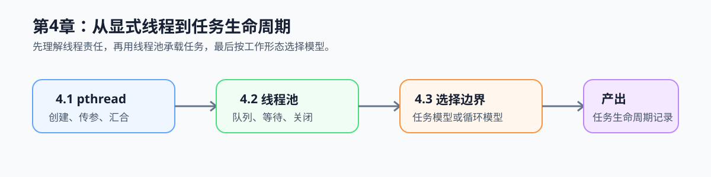

# 第4章 Host 任务并行：线程与线程池

## 章节定位与总览图

本章把第一篇工作负载记录卡中的“采集 -> 队列 -> 帧预处理”交接落成 Host 线程模型：先看线程生命周期，再看线程池如何复用工作线程，最后判断何时应将规则循环交给 OpenMP。

*学习路线图：先建立线程的创建与汇合边界，再将多个短任务交给线程池，最后按工作形态选择线程池或 OpenMP。*

## 前置基础

- 已理解第一篇中的共享状态、等待谓词、关闭后排空和模式选择。
- 需要完成 Task 0 的 C 构建；不要求已掌握 pthread API。

## 学习路径

1. 先读[本章导语](./intro.md)，建立线程生命周期与任务生命周期的区分。
2. [4.1 pthread 生命周期](./01-pthread-basics.md)：明确创建、传参、执行与 `join` 汇合边界。
3. [4.2 线程池](./02-thread-pool.md)：将队列、等待/唤醒和关闭规则组合为可复用执行结构。
4. [4.3 模型选择](./03-model-selection.md)：按不规则任务或规则循环选择线程池、OpenMP 或 SIMD。

## 配套实践

- 运行 [`ch04_task_pool`](../../../examples/ch04_task_pool/README.md) 的两组粒度对照：`./build/ch04_task_pool 1048576 256 2 64` 与 `./build/ch04_task_pool 1048576 16384 2 64`。两组都必须通过数值校验。
- 在[工作负载记录卡的任务交接区](../../learning-tools/workload-record-card.md#2-任务交接)基础上，产出任务生命周期记录：任务如何入队、谁等待、何时在锁外执行、如何关闭并汇合结果。
