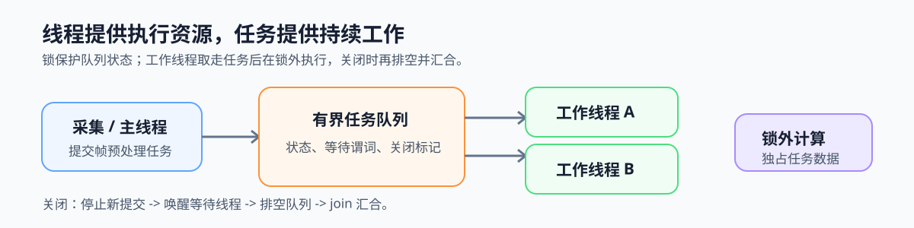

# 第4章 Host 任务并行：线程与线程池

## 本章问题

第一篇已经为视频分析流水线写下队列交接规则。本章将其落实为可运行的 Host 结构：线程应长期驻留还是随任务创建，任务何时入队、何时在锁外执行，关闭时如何确保剩余任务被排空并汇合。

## 核心模型：线程提供执行资源，任务提供持续工作

线程通常只创建一次、处理多个任务；任务可以短暂、排队、失败或被拒绝。线程池以有界队列连接提交者和长期驻留的工作线程，并在关闭后排空队列、汇合所有线程。

*图4-0：主线程提交帧预处理任务，队列交给长期驻留的工作线程；队列状态在锁内更新，任务计算在锁外进行，关闭后按排空与汇合规则收口。*

## 章节逻辑

4.1 先用 pthread 暴露创建、传参和汇合边界。4.2 再将第一篇的队列、等待和关闭规则组织为线程池。4.3 最后比较不规则任务与规则循环，避免仅因“都使用线程”就把线程池、OpenMP 和 SIMD 混为同一选择。

这条路线先理解显式线程承担的责任，再观察线程池如何复用这些责任，最后确定何时应使用更高层的循环模型。

## 应用语境

视频分析服务中，采集端不断生成帧预处理任务，线程池从队列取任务并执行，结果再交给后续推理或编码阶段。`chunk` 太小时，队列操作和唤醒会吞掉计算收益；`chunk` 太大时，少数长任务又会让其他线程提前空闲。

第4章实验只用于观察这些粒度取舍和正确性边界，不以某次加速比作为通用结论。
