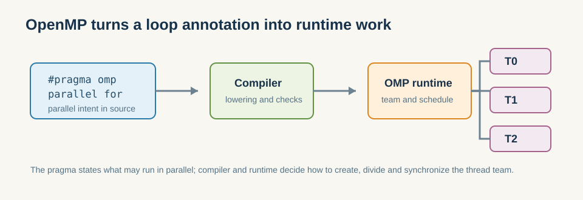

# 5.1 编译指令模型

- `parallel for`：并行化循环。`sections`：并行化不同代码块。`task`：动态任务。
- 一行 `#pragma omp parallel for` 的威力与边界。

*图 5-1：pragma 只声明并行意图；编译器负责改写，OpenMP 运行时负责创建线程团队、切分任务并完成汇合。*

这一节先回答一个最关键的问题：为什么 OpenMP 的入口几乎总是从循环开始。  
原因很简单，CPU 端最常见的并行负载，就是“对大量独立元素做同一种操作”，而编译指令正好能把这种循环密集型工作低侵入地交给运行时处理。

### 5.1.1 为什么 OpenMP 适合从循环开始

CPU 端最常见的并行负载，就是“对大量独立元素做同一种操作”。  
这类任务天然适合循环拆分，所以 OpenMP 的 `parallel for` 成了最常见的入口。它把“分线程、分区间、等待汇合”这几步隐藏起来，让读者能先把注意力放在问题本身，而不是线程创建细节。

### 5.1.2 一行 pragma 能做什么，不能做什么

`#pragma omp parallel for` 能帮助你快速并行化规则循环，但它并不会替你解决所有问题：

- 不能自动修复错误的数据共享定义。
- 不能自动判断你的循环是否真的足够大。
- 不能自动保证负载均衡。

所以 OpenMP 的价值在于“低侵入”，而不是“无脑并行”。

**小结**
OpenMP 的起点是语法，但落点是运行时调度。它把“这段循环可以并行”这件事表达出来，再由编译器和运行时补完线程切分、等待和汇合。下一节要看的，就是这种表达为什么离不开共享/私有化边界。
