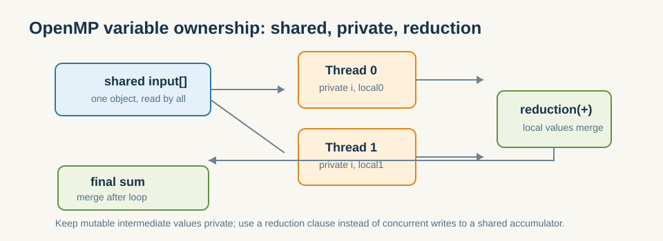

# 5.2 数据共享与私有化

- `shared` / `private` / `firstprivate` / `reduction` 子句。
- 归约子句如何安全地合并各线程的部分结果（对照第3章 Reduce）。

*图 5-2：输入可只读共享；可变中间结果应私有化；各线程局部累计值应在循环末尾通过 reduction 合并。*

这一节要解决的是 OpenMP 里最重要、也最容易出错的问题之一：变量到底归谁管。  
只要共享、私有、归约这三类边界没有先讲清楚，OpenMP 就很容易从“低侵入并行”变成“看起来简单、实际很危险”的代码。

### 5.2.1 共享变量为什么最容易出错

OpenMP 最容易出问题的地方，不是语法，而是变量归属关系：

- 这个变量是不是每个线程都能改？
- 这个变量是只读共享，还是线程私有？
- 中间结果应该在本地累积，还是直接写回全局？

如果这些边界没想清楚，就会出现竞态、错误归约或难以复现的结果。

**小结**
OpenMP 最容易出错的地方不是并行本身，而是变量作用域。共享、私有、归约这三类边界一旦明确，很多循环并行化问题就会从“玄学”变成“规则题”。下一节会进一步看调度策略如何影响这种规则题的效率。
