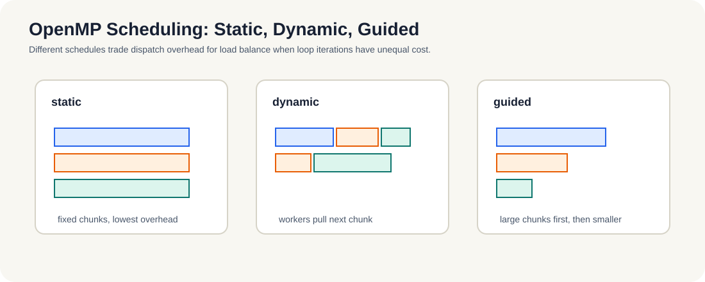

# 5.3 调度策略

- `static` vs `dynamic` vs `guided`：负载均衡 vs 调度开销的权衡。

*图 5-3：`static` 的分发成本低，适合工作量均匀的循环；`dynamic` 通过领取下一块改善负载不均；`guided` 先分大块再逐步缩小，平衡调度成本与尾部不均衡。*

这一节讨论的是“线程什么时候去拿下一块工作”。  
同样是一段循环，不同的调度策略会把“省开销”和“保均衡”放在不同位置，因此它直接决定 OpenMP 在真实负载里到底是顺手还是别扭。

### 5.3.1 调度策略其实是在回答“谁来切分工作”

如果任务非常均匀，`static` 最省开销；如果任务很不均匀，`dynamic` 或 `guided` 更稳。  
这意味着调度策略不是“语法选项”，而是在替你决定：

- 工作切得多细；
- 线程多久去拿一次新任务；
- 负载不均时，是宁愿多一点调度开销，还是宁愿少一点同步。

**小结**
调度策略本质上是在分配“省开销”与“保均衡”的优先级。任务均匀时优先减少调度成本，任务不均时优先避免线程空转。下一节的模糊示例，会把这种差异落到更真实的访存和局部性上。
