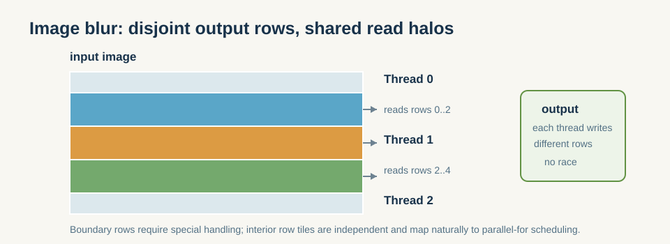

# 5.4 实战：图像模糊的 OpenMP 并行化

- 计算密度高于向量加法，能展现更真实的多线程加速比。

*图 5-4：线程可以独占输出行块，但计算每个输出行仍需读取相邻输入行；图像边界需要单独处理。*

这一节把前面三节的概念放回一个更接近工程的场景里。  
图像模糊比向量加法更适合观察 OpenMP 的原因，不只是计算量更大，而是它把访存、边界处理、调度策略和缓存局部性都放在了同一个问题里。

### 5.4.1 为什么这里比 vec_add 更适合观察调度差异

向量加法太规整，很多调度策略的差异并不明显；图像模糊则更容易展示真实工程里的几个问题：

- 访存模式更复杂；
- 行列边界更敏感；
- 不同区域的工作量可能不完全一致；
- 线程调度和缓存局部性会开始影响结果。

所以这类示例更适合拿来观察 OpenMP 的“工程手感”，而不只是验证语法。

### 5.4.2 你运行时应该看什么

做这个实战时，重点不只是看结果对不对，还要看：

- 并行前后耗时变化；
- `static` 和 `dynamic` 的差别；
- 线程数增加后是否还能继续收益；
- 代码复杂度是否仍然可控。

**小结**
图像模糊把 OpenMP 的几个关键点放到了同一个场景里：数据共享、调度策略、边界处理和缓存局部性。它比向量加法更接近真实工程，因此更适合用来判断 OpenMP 是否真正适合你的工作负载。

---

**本章要点**
1. OpenMP 用 pragma 实现低侵入式并行，适合循环密集型代码。
2. 数据共享子句决定正确性，归约子句安全合并部分结果。
3. 调度策略需按负载均衡程度选择。
4. OpenMP 的价值不是“完全替你写并行”，而是让 CPU 端并行化成本足够低。

**本章小结**
第5章把“线程并行怎么做”提升成“并行意图怎么声明”。它的重点不是某个 pragma 的语法，而是让循环拆分、数据归属和调度策略都变成可控的显式选择。下一章会继续向下走一层，看看单核内部是怎么靠 SIMD 把吞吐再往上提的。

**动手实验**：在 `examples/ch09_vec_add` 上切换 `schedule(static|dynamic)`，观察带宽受限负载下调度的（微小）影响；再在图像模糊上观察显著差异。
