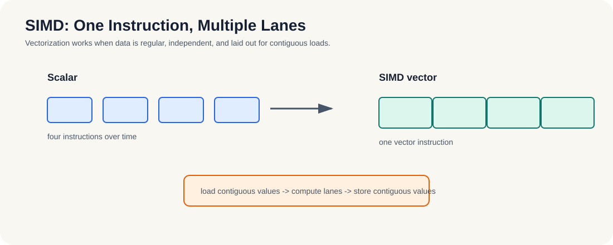

# 6.1 SIMD 概念

SIMD（Single Instruction Multiple Data）不是“更快的函数调用”，而是 CPU 在单个执行流里，把同一条操作广播到多个数据 lane 上。

这一节先把最核心的概念讲清楚，因为后面的 NEON、AVX、自动向量化和 intrinsics 都是在这件事上继续展开：**一次指令能同时处理多少数据**。

- 标量执行：一条指令处理一个数据元素。
- SIMD 执行：一条指令同时处理多个数据元素。
- 与多线程的区别：SIMD 发生在单核内部，多线程发生在多执行单元之间。

*图 6-1：标量代码按时间逐个处理元素；SIMD 把多个独立元素放进 lane，用一条向量指令并行处理。连续布局、无跨元素依赖和对齐访问决定向量化是否有效。*

### 6.1.1 为什么 SIMD 常被低估

很多 CPU 程序即使已经多线程化，性能仍然会被单核内部的标量执行拖住。  
这时候 SIMD 的价值就体现出来了：它不增加线程数量，也不改变任务分工，而是把“单次计算能同时处理多少数据”这件事抬高。

从机制上看，SIMD 的性能提升来自“同一条指令驱动多个 lane”这个事实。只要数据布局足够规整，标量循环就能被压缩成更少的向量指令；如果数据不规整，向量宽度再大也很难吃满。

这一点和第3章的 Map 模式很接近：每个元素彼此独立，天然适合广播式执行。

**小结**
SIMD 的核心不是“更多线程”，而是“更宽的执行”。理解这一点后，就能把它和多线程区分开来：线程解决任务分工，SIMD 解决单次计算的吞吐。下一节会看具体架构里的向量寄存器是怎么承载这种能力的。
