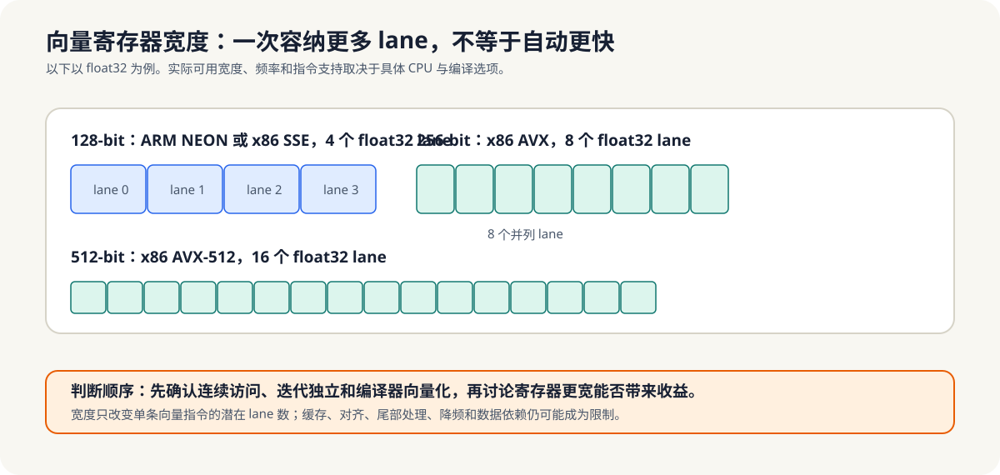

# 6.2 ARM NEON 与 x86 AVX 简介

NEON 和 AVX 是不同架构上的 SIMD 实现，但它们背后的机制是一样的：把数据打包进更宽的向量寄存器，再用向量指令一次处理一组 lane。

这一节的目的，不是让你记住所有指令名，而是建立一个更稳定的判断：**硬件形态会变，但向量化的基本逻辑不会变**。只要这层逻辑清楚，后面看不同架构的 SIMD 就不会只剩名词差异。

- 概念级介绍向量寄存器宽度（128/256/512 位）与典型指令族，不写汇编。
- 不同架构的差异，主要体现在寄存器宽度、指令集合和编译器支持程度。

*图 6-2：以 `float32` 为例，128-bit 寄存器可容纳 4 个 lane，256-bit AVX 可容纳 8 个，512-bit AVX-512 可容纳 16 个。lane 更多只是潜在并行度，连续访问、依赖、对齐和编译器生成的指令决定实际收益。*

### 6.2.1 寄存器宽度意味着什么

更宽的寄存器并不自动等于更快，它只是说明一次可以承载更多数据。  
真正能不能吃满 SIMD，还要看：

- 数据是否连续；
- 数据是否对齐；
- 算法是否有循环依赖；
- 编译器是否能看懂访问模式。

这也是为什么“看寄存器宽度”只是第一步。真正决定 SIMD 速度的，是数据能否被连续、对齐、无依赖地装入向量寄存器，以及编译器是否能把你的循环识别成可向量化模式。

**小结**
NEON 和 AVX 的差异主要在硬件形态，背后的向量化逻辑却是同一套：更宽的寄存器、更规整的数据、更少的依赖。真正要比较的不是名词，而是你的数据布局能不能喂满这些 lane。
