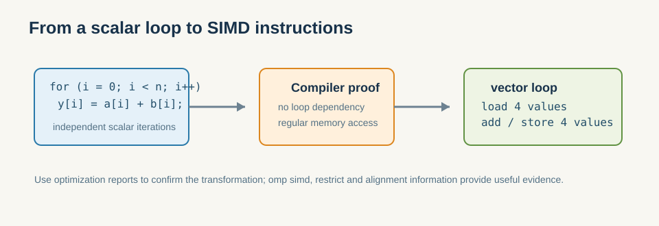

# 6.3 编译器自动向量化与 `#pragma omp simd`

自动向量化的本质，是编译器先证明“这段循环可以安全地并行到向量 lane 上”，再把标量迭代改写成向量迭代。

这一节是第6章最实用的一层：它告诉你，大多数时候不必先手写 intrinsics，而应该先让编译器替你做自动向量化。  
这也和前面的 OpenMP 章节形成呼应：先用声明和约束帮编译器看懂代码，再决定是否需要更低层控制。

- 让编译器自动向量化的条件（无依赖、对齐、连续访问）。
- 用 `-O3 -fopenmp` 与 `#pragma omp simd` 提示编译器。
- 如何用编译器报告（`-fopt-info-vec`）确认是否真的向量化了。

*图 6-3：编译器必须先证明跨迭代无依赖、访问规则，才能把多个标量迭代合并成一条 SIMD 向量操作。*

### 6.3.1 自动向量化为什么应该优先

绝大多数时候，你不需要一开始就写 intrinsics。  
只要代码足够规整，编译器就能把标量循环改成向量循环；而你需要做的，是帮助编译器证明这段循环：

- 没有跨迭代依赖；
- 内存访问是连续的；
- 对齐条件尽可能满足；
- 数据布局不会阻碍向量装载。

这也是为什么第3章里的 Map 模式会频繁映射到 SIMD：它本质上就是“对大量独立元素施加同一操作”。

从机制上说，自动向量化最依赖三类信息：

1. **数据依赖信息**
   - 编译器必须判断迭代之间是否互相独立。
2. **内存访问模式**
   - 连续、规则、对齐的访问更容易向量化。
3. **语义提示**
   - `#pragma omp simd`、restrict、对齐声明，都会帮助编译器做更激进但仍安全的改写。

所以，自动向量化不是“编译器猜你想要什么”，而是“你把足够明确的证据给编译器，让它可以合法地把标量循环提升为向量循环”。

**小结**
自动向量化应该是 SIMD 的默认入口，因为它把“怎么发向量指令”交给编译器处理。程序员的主要工作，是把数据依赖、内存访问和语义提示整理清楚，让编译器有机会做对。下一节才轮到 intrinsics 这种更强控制的做法。
