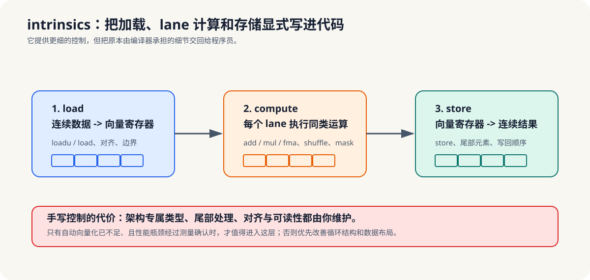

# 6.4 intrinsics 基本用法（🔬 进阶，点到为止）

intrinsics 的机制意义，是把“编译器自动决定如何向量化”改成“程序员显式指定加载、计算、存储的向量步骤”。

这一节只点到为止，因为 intrinsics 代表的是“最后一层控制”。  
在教材结构里，它的作用不是让你一开始就依赖手写向量指令，而是让你知道：当自动向量化不够用时，还有一层更细的控制手段可选。

- 何时需要手写 intrinsics、基本数据类型与加载/计算/存储三段式。

*图 6-4：intrinsics 让加载、lane 计算和存储顺序显式可见，也把对齐、尾部处理和架构差异交给程序员维护。它是自动向量化后的受限控制手段，不是默认起点。*

### 6.4.1 什么时候才值得手写

intrinsics 适合两类场景：

1. 编译器已经尽力，但还是没能正确向量化。
2. 你需要更明确地控制数据加载、计算和存储顺序。

但它的代价也很明显：

- 可移植性差；
- 代码可读性下降；
- 不同架构要写不同版本。

所以 intrinsics 应该被视为“最后手段”，而不是默认方案。

更准确地说，intrinsics 适合的是“编译器已经接近正确答案，但你需要最后一层控制”的场景。它提供的是可见性和可控性，而不是自动化。你写的每一次加载、每一次 lane 计算、每一次回写，都会直接成为最终执行路径的一部分。

**小结**
intrinsics 不是 SIMD 的起点，而是最后一层控制手段。只有在自动向量化不够用、或者你确实需要手工控制内存访问和 lane 操作时，才值得付出这类复杂度。下一节会把 SIMD 放回整个 CPU 体系里，说明它和线程、OpenMP 的关系。
