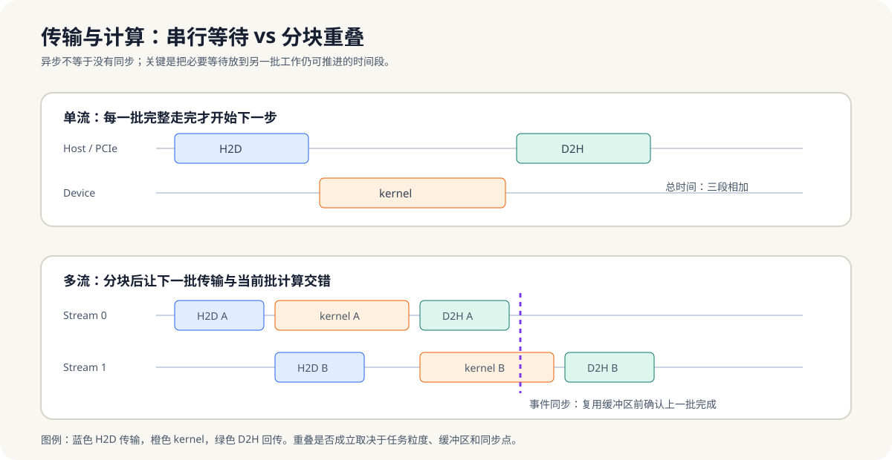

# 7.3 数据搬运与流重叠

当算子很短或输入很小，Host-Device 传输与同步往往比计算本身更显眼。优化这类路径的起点通常不是继续压缩 kernel，而是减少往返、合并批次，并让独立批次在传输和计算上重叠。

*图 7-1：单流逐批等待时，H2D、kernel 和 D2H 串行累加；分块并使用多 stream 后，下一批传输可与当前批计算重叠，但缓冲区复用前仍需等待对应事件。*

## 三个优先判断

1. **少传**：结果如果只由后续 Device 阶段消费，就不应先回传 Host。
2. **批量传**：避免将大量微小请求拆成独立 PCIe 往返；批次大小应同时考虑延迟、内存占用和排队。
3. **重叠传**：把可独立的输入切为分块，在一块计算时准备或传输下一块。

重叠不能消除传输总量，只能减少传输与计算在时间线上互相等待的部分。若 kernel 很轻、链路已饱和或分块过细，更多 stream 反而会增加调度与缓冲管理成本。

## 用实验建立判断

[ch07_host_overlap](../../../examples/ch07_host_overlap/README.md) 提供最小对照。固定总输入后，依次改变 `chunk` 与 `streams`，记录：

- 总耗时与正确性；
- 每块大小变化后，吞吐是否改善；
- stream 数增加后，收益何时趋于饱和；
- CUDA 路径中的 H2D、kernel、D2H 是否真的发生重叠。

实验结果必须同时记录输入规模、分块大小、stream 数和硬件环境。没有 CUDA 环境时，CPU 路径仍可用于理解分块、排队和收口，不应把模拟或其他机器的数字当成本机实测。

## 常见错误模式

- 每个小任务独立传输，PCIe 往返延迟主导总时间。
- 每次提交后立刻同步，异步 API 退化为串行调用。
- stream 数很多，但复用同一块尚未完成的缓冲区。
- 只测 kernel 时间，忽略输入准备、传输、等待和结果回收。

**小结**
传输路径的目标是少传、批量传和条件满足时重叠传。第7章至此完成 Host 控制面的收口：任务要被承载，循环要被划分，数据要被有效处理，跨设备工作还必须由 Host 决定数据、提交和同步的节奏。下一章从 Device 视角展开 Host/Device 内存模型与协处理器选择。
