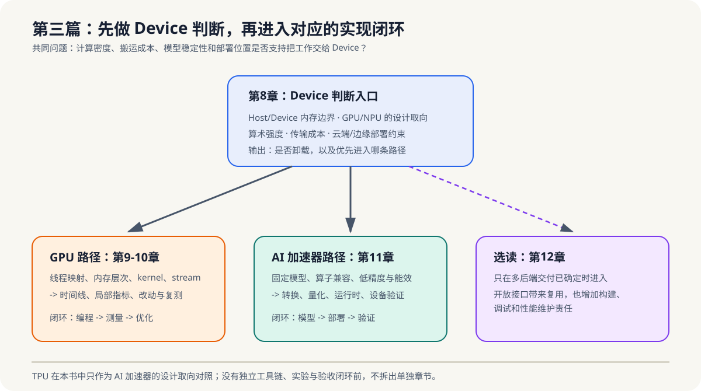

# 第三篇：Device 执行模型、GPU 编程与 AI 加速器部署

> 目标：先判断负载是否值得越过 Host/Device 边界，再分别建立 GPU 的编程与性能闭环，以及 NPU 类设备的模型部署闭环。TPU 只作为设计取向对照；第12章只做跨平台选读。约120页。

*图 3-0：第8章是共同的 Device 判断入口。GPU 路径在第9-10章完成“编程 -> 测量与优化”闭环；AI 加速器路径在第11章完成“模型 -> 转换/量化 -> 运行时验证”闭环；第12章只在多后端交付已确定时进入。*

## 本篇章节

- [第8章 Device 执行模型与加速器选择](chapter08-coprocessor-overview/README.md)
- [第9章 GPU 编程与基础算子（以 CUDA 为例）](chapter09-gpu-cuda/README.md)
- [第10章 GPU 性能分析与云端视角](chapter10-gpu-profiling/README.md)
- [第11章 AI 加速器与部署链路](chapter11-npu-tpu/README.md)
- [第12章 跨平台编程模型（选读）](chapter12-cross-platform/README.md)

## 阅读路线

- **GPU 路径**：第8章 -> 第9章（向量加法、归约、矩阵乘）-> 第10章。先做上 Device 判断，再完成“编程 -> 测量 -> 优化”。
- **AI 加速器路径**：第8章 -> 第11章 -> 第14章 -> 第16章。先判断模型和部署位置，再完成“转换/量化 -> 运行时 -> 设备验证”。
- **可移植性路径**：仅在多后端交付已确定时阅读第12章；它不替换 CUDA 或厂商运行时主线。
- **决策阅读**：第8章计算密度估算、第11章 GPU/NPU 部署边界、第12章的可移植性成本。

## 范围边界

第8章负责 Device 判断；第9-10章构成 GPU 编程与诊断主线；第11章构成以 NPU 为实践对象的 AI 加速器部署主线。TPU 只作为设计取向对照，本篇不承诺 TPU 平台实操；第12章也只补充开放标准的可移植性边界。
