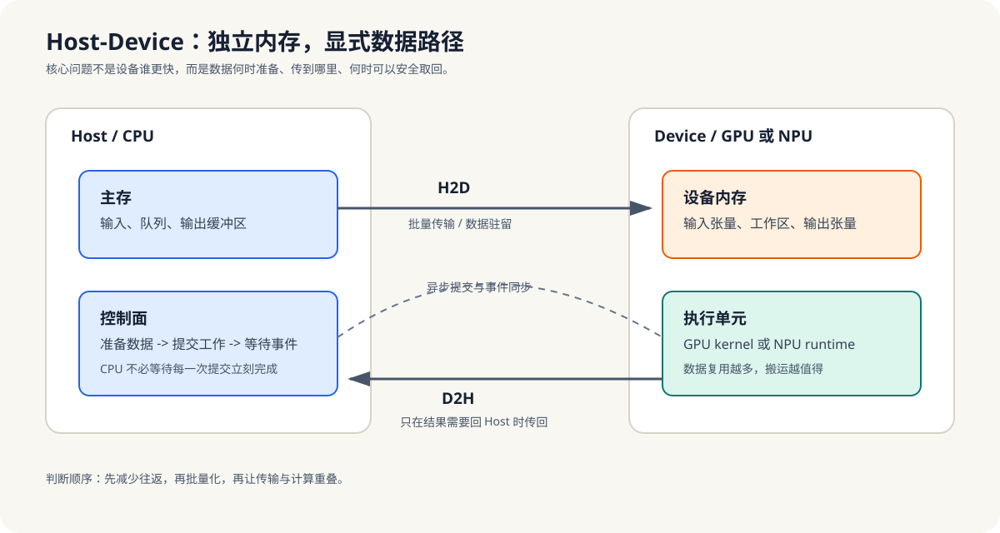

# 8.1 主-从内存模型：Host ↔ Device

Host/Device 不是“一个更快，一个更慢”，而是两套独立内存空间，通过互联总线协同工作。

这一节先把异构计算里最基础、也最容易误解的边界立起来：**数据不是天然共享的，搬运本身就是系统的一部分**。  
后面无论是 CUDA、NPU 还是 OpenCL，这个前提都不会变。

- Host（CPU）与 Device（GPU/NPU）各有独立内存，通过 PCIe/总线连接。
- 数据必须显式搬运（除统一内存外）；这是异构编程一切复杂性的根源。

*图 8-1：Host 和 Device 各自维护内存。高效路径不是频繁往返，而是让 Host 批量准备和提交，让数据在 Device 侧尽可能复用，并在真正需要结果的同步点回收。*

机制上，只要数据送到 Device，就必须提前决定“谁来准备”“什么时候传”“传多少”“什么时候拿回来”。这些问题会在第9章和第11章里反复出现，所以第8章先把它们作为判断门槛讲清楚。

**小结**
Host/Device 的边界一旦明确，异构编程的大部分复杂性就会变得可解释：不是“为什么要麻烦地拷贝”，而是“因为两侧内存本来就不共享”。下一节会进一步把协处理器拆成 GPU 和 NPU 两类，说明它们为什么不能混为一谈。
