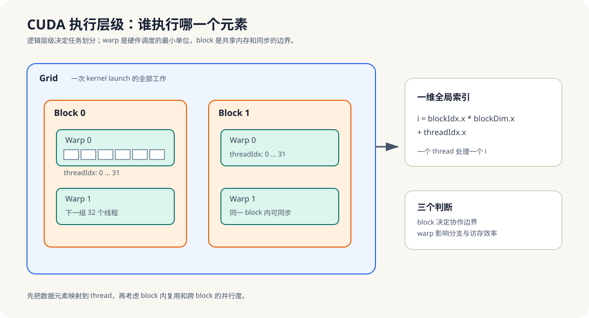
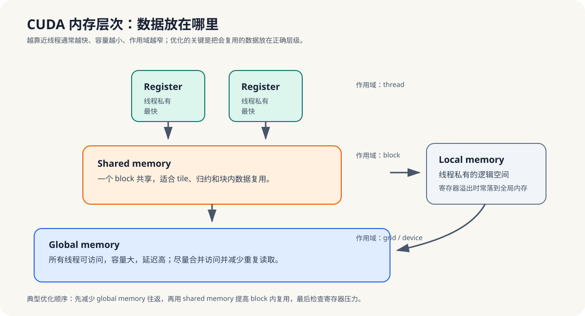

# 9.1-9.2 CUDA 线程层次与内存层次

## 9.1 CUDA 线程层次：grid, block, warp

- **grid → block → thread** 三级层次；**warp**（32 线程）是硬件调度的最小单位。
- 全局线程索引计算：`blockIdx * blockDim + threadIdx`。

*图 9-1：Grid 描述一次 kernel 的全部工作，block 是线程协作和共享内存的边界，warp 是硬件调度的最小单位。先建立元素到 thread 的映射，再讨论 block 内复用。*

## 9.2 CUDA 内存层次：全局、共享、局部、寄存器

- 全局内存（大、慢、所有线程可见）、共享内存（块内共享、快）、寄存器（线程私有、最快）、局部内存（寄存器溢出）。

*图 9-2：寄存器面向单线程局部状态，共享内存面向 block 内复用，全局内存面向设备范围的数据交换。优化时先减少全局内存往返，再检查共享复用与寄存器压力。*

**小结**
线程层次决定“谁来干活”，内存层次决定“数据放哪儿”。第9章后续优化之所以都围绕索引、复用和同步展开，本质上就是在这两个层次上找最合适的配合方式。
