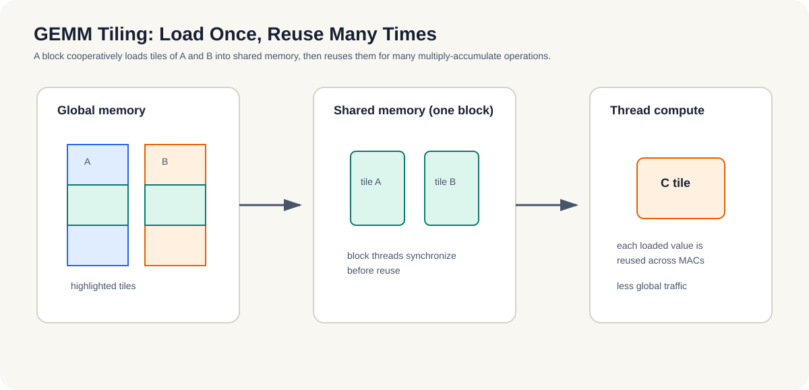

# 9.4-9.6 三个实战案例

这一组案例的目的，不是把代码堆满，而是让你先学会用问题类型来选优化手段：先判断是带宽、同步还是计算在卡住，再决定该改哪里。

## 9.4 实战1：向量加法（CPU串行 vs OpenMP vs CUDA）✅

- 完整可运行：`examples/ch09_vec_add/`。
- ⚡️ 关键教训：向量加法是**带宽受限**，每个元素只做一次加法，却要读两个、写一个 float。
- 观察重点：`serial`、`OpenMP`、`CUDA` 的差距，通常会被内存带宽和 H2D/D2H 传输开销限制，特别是小数据量时。

## 9.5 实战2：归约（共享内存优化前后对比）

- `examples/ch09_reduce/` 已补齐最小可运行骨架：串行版、OpenMP 版、CUDA 朴素版、CUDA 共享内存版。
- 这个例子要看的是：跨线程依赖如何让“直接并行”失效，以及为什么要靠块内同步和共享内存来减少全局原子操作。
- 涉及块内同步 `__syncthreads()`、分支发散、bank 冲突和 warp 内最后一级归约。

## 9.6 实战3：矩阵乘（分块平铺 + 共享内存）

- **计算受限**的代表，能真正展现 GPU 威力（对照 9.4 的带宽受限）。
- 朴素版 → 分块平铺（tiling）复用共享内存，减少全局内存访问。
- 代码位置：后续补充到 `examples/`，作为第9章的第三个对照案例。

*图 9-3：同一 block 协作把 A、B 的一小块载入共享内存，再让多个线程反复使用。tile 的价值不在“切得更小”，而在减少全局内存读取并提高每次搬运的数据复用。*

**小结**
三个实战的作用，是把 GPU 上最常见的三类特征摆出来：带宽受限、同步受限和计算受限。理解这三种情况，后面再看流、异步和陷阱，就更容易知道自己应该优先改哪里。
