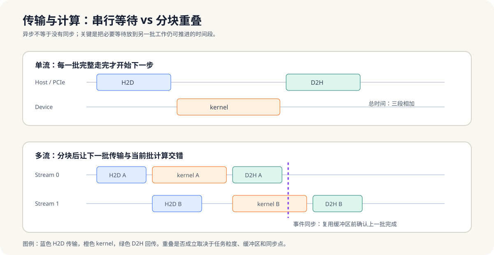

# 9.7 流（Stream）与异步执行

这一节解决的是一个很实际的问题：当单个 kernel 已经写对了，怎么把“拷贝”和“计算”拆开，让 GPU 不因为等待传输而空转。

- 用多个 Stream 让数据传输与核函数计算重叠，隐藏 PCIe 延迟。

*图 9-4：多流优化的目标是缩短端到端关键路径，而不是让每一步都异步。只有任务足够大、缓冲区独立、同步点放在复用前时，传输与计算才能形成有效重叠。*

**小结**
Stream 和异步执行的意义，是把“拷贝”和“计算”从串行链条里拆开。只要任务足够大、分块足够合理，就有机会把 PCIe 往返藏到计算后面。
