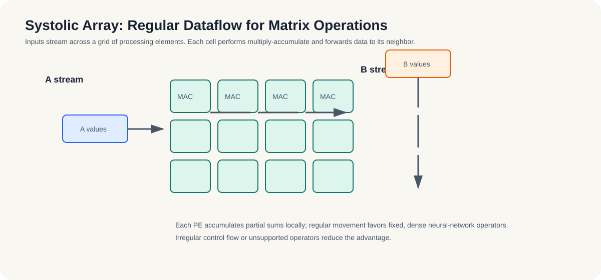

# 11.1-11.2 硬件特点与设计哲学

## 11.1 硬件特点简述

NPU/TPU 这类硬件不是“更快的 GPU”，而是针对神经网络计算模式设计的专用加速器。它们最擅长的是卷积、矩阵乘、激活、归一化这类规则、密集、可流水化的计算，典型目标是用更低功耗换更稳定的吞吐。

- **脉动阵列（systolic array）**：数据像脉搏一样流过计算单元，专为矩阵乘/卷积优化。
- **近存计算**、**低精度支持**（INT8/FP16）：强调减少搬运、提高能效。

*图 11-1：脉动阵列让输入数据沿规则方向流过多个处理单元，每个单元完成乘加并保留部分和。规则、密集、可流水的矩阵运算最能发挥这种结构的能效优势。*

对读者来说，最重要的不是电路细节，而是一个判断标准：如果你的模型是稳定的、重复执行的、以推理为主，并且功耗和体积约束很强，NPU 才是值得认真考虑的目标。

**小结**
这一节先把 NPU 的硬件气质讲清楚：它不是“更快的 GPU”，而是围绕固定神经网络工作负载优化出来的能效型加速器。理解这个前提后，后面的转换、量化和部署流程才知道自己到底是在适配什么。

## 11.2 为什么 NPU 和 GPU 设计哲学不同

GPU 和 NPU 的差别，核心在于“灵活性”与“能效”的取舍。

- **GPU = SIMT**：适合通用并行，算子变化多、图结构变化大时更灵活。
- **NPU = 数据流**：适合固定图、固定输入输出、固定批次的高能效推理。

可以把它理解成两种工程目标：

- GPU 追求“什么都能跑、还能跑得不错”。
- NPU 追求“固定工作负载下尽可能省电、尽可能稳定”。

因此，选型标准很直接：

- 如果模型变化频繁、算子经常改，优先 GPU。
- 如果模型已经固定，且要进入量产或边缘场景，NPU 更合适。

**小结**
GPU 和 NPU 的分工，本质上是通用性和能效之间的取舍。第11章后面的流程之所以要强调“先固定接口，再做转换”，就是因为 NPU 的价值建立在工作负载稳定这件事上。
