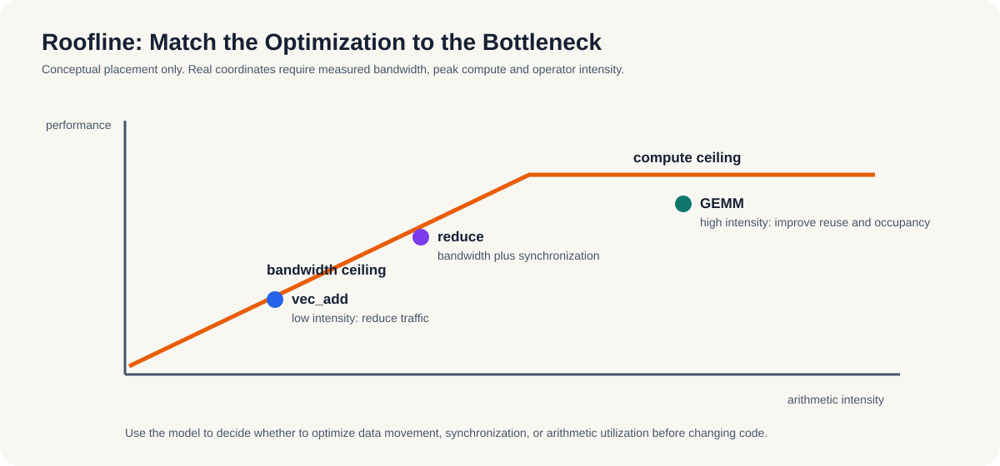

# 13.3-13.4 瓶颈模式与实验对照

这一部分把前面的判断框架落到可观察的瓶颈类型上，帮助你把“慢”翻译成具体原因。

## 13.3 常见性能瓶颈模式

- 带宽受限：算术强度低，如向量加法。
- 计算受限：算力打满，如矩阵乘。
- 延迟受限：被同步或传输往返拖累，如频繁小批量 H2D。

*图 13-1：`vec_add` 更接近带宽受限，`reduce` 还受同步影响，GEMM 更接近计算受限。图中的位置是教学性示意，真实位置必须由目标设备的带宽、峰值算力和实测算术强度确定。*

## 13.4 实验对照

- `examples/ch09_vec_add`：验证带宽受限。
- `examples/ch09_reduce`：验证同步/原子开销。
- 第9.6节矩阵乘：验证计算受限。
- 结论：先判瓶颈类型，再选优化手段。

**小结**
第13章的核心收口很简单：先判断瓶颈属于哪一类，再决定要改算力、带宽还是同步。只要瓶颈类型判断对了，后面的优化手段才有意义。

**动手实验**：先看 `examples/ch09_vec_add`，再看 `examples/ch09_reduce`，最后看第9.6节矩阵乘。
