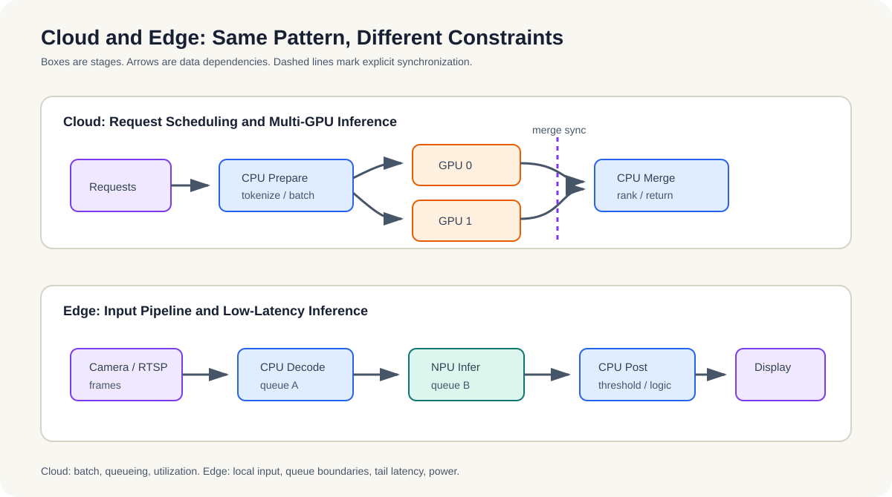

# 案例2：大模型推理的异构调度

这一案例把视角从边缘视觉切到大模型推理，重点看 CPU、GPU 和多卡之间如何拆分请求、批次和结果汇聚。

## 问题是什么

大模型推理不是“把一个大模型扔给 GPU 跑完”这么简单。真正的问题是：当模型很大、输入很多、显存有限、批次又不能太大时，如何把预处理、切分、推理和结果汇聚拆开，并让它们尽量并行。

案例2说明的是调度思路：

- CPU 先做 tokenization / preprocessing
- GPU 做主推理
- 多 GPU 之间做负载分配
- 结果再汇聚到 CPU 或上层服务

*图 14-2：云端把 CPU 预处理、请求分配、多 GPU 推理和汇聚组织成吞吐路径；边缘端把输入、NPU 推理、后处理和输出组织成低延迟流水线。两者都必须明确数据依赖和同步点。*

## 为什么要把 CPU 放进来

很多人一看到大模型，就只想着 GPU。实际上，CPU 在这里并不是陪衬，它常常负责：

- 文本切分
- tokenization
- batch 组装
- 请求调度
- 结果后处理

如果这些工作都压在 GPU 上，GPU 可能被大量小任务和同步开销拖慢，反而影响整体吞吐。

## 多 GPU 的核心矛盾

多 GPU 方案的核心矛盾不在“有没有两块卡”，而在于：

1. 输入怎么分片。
2. 中间激活怎么流转。
3. 哪些阶段可以并行，哪些阶段必须同步。
4. 通信开销是否会吞掉并行收益。

如果分片策略不对，多 GPU 反而会比单 GPU 更慢。  
第14章讲现象，第15章讲调度原则。

## 适合画什么图

图可以画成“CPU + 多 GPU”的流水线：

- 左边是输入请求和 CPU 预处理
- 中间是 GPU0 / GPU1 / GPU2 的并行推理
- 右边是结果汇聚和返回

图上明确：

- 输入分片点
- GPU 间同步点
- 结果汇聚点

图注可写成：

`CPU 负责预处理和调度，多 GPU 负责并行推理，结果在 CPU 侧汇聚`

## 这个案例说明什么

它说明的不是某个特定框架，而是一个通用判断：

- 如果预处理重，CPU 不能缺席。
- 如果显存紧，多 GPU 不一定天然更好。
- 如果通信多，流水线设计比单卡性能更重要。

所以案例2更偏系统设计方法，而不是可运行示例。

**小结**
这个案例要读出的是调度思路：预处理、推理和汇聚必须被拆开看，多 GPU 也不是天然更优。分片、同步和通信一旦设计不好，设备越多反而越慢。
